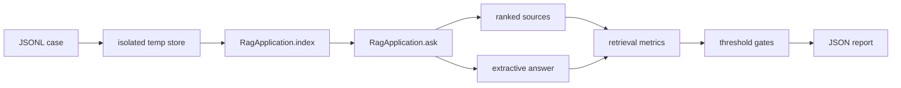

# RAGX Evals

## 1. Purpose

Unit tests answer "do functions and modules behave according to their code contracts"; evals answer "does the RAG system still find the correct evidence and produce an admissible answer based on that evidence."

RAGX uses a two-tier evaluation system:

| Tier | Current Status | Purpose |
| --- | --- | --- |
| Offline deterministic eval | Implemented | No network, low cost, reproducible; the first quality gate layer for PRs |
| Online model eval | Planned | Detects model upgrades, prompt changes, hallucinations, cost, and vendor drift |

The existing `ragx_cli.py evaluate` is a single-shot retrieval diagnostics entry point and is not equivalent to a full eval suite. A full suite is also responsible for dataset versioning, thresholds, per-case isolation, aggregate metrics, reports, and exit codes.

## 2. Directory Layout

```text
evals/
├── datasets/
│   └── core-rag.jsonl        # 离线核心场景
└── thresholds.json           # 发布门槛

rag/evals/
├── models.py                 # case、threshold、result、report 契约
├── runner.py                 # 隔离执行、指标、hash 和 gate
├── __main__.py               # python -m rag.evals
└── __init__.py               # 公共 API
```

## 3. Execution

Report only:

```bash
python3 -m rag.evals
```

Non-zero exit when a quality gate fails:

```bash
python3 -m rag.evals --fail-on-regression
```

Saving the report:

```bash
python3 -m rag.evals \
  --dataset evals/datasets/core-rag.jsonl \
  --thresholds evals/thresholds.json \
  --output .ragx/evals/core-rag.json \
  --fail-on-regression
```

CI and release pipelines must use `--fail-on-regression`. Local diagnostics may omit it so the full report can still be inspected when the quality gate fails.

## 4. Execution Model

Each case uses:

1. Its own isolated temporary directory.
2. Its own SQLite vector store and manifest.
3. The synthetic documents declared by the case itself.
4. Deterministic hashing embeddings.
5. The real RAGX layout analysis, chunking, indexing, hybrid recall, RRF, and reranking implementations.
6. A deterministic generation provider that extracts the body of the first piece of evidence.
7. After completion, the store is closed and all temporary data is deleted.



The deterministic provider does not simulate real model capabilities. Its role is to:

- Verify the prompt contains the correct evidence.
- Verify the first piece of evidence received by the generation stage supports the key facts.
- Keep PR evals free of network cost and unaffected by model randomness.
- Leave real model quality to a separate online shadow eval.

## 5. Data Contract

Each JSONL line is one complete case:

```json
{
  "case_id": "expense-deadline",
  "category": "policy-fact",
  "description": "Expense policy retrieval.",
  "documents": [
    {
      "source": "expense-policy.md",
      "content": "# 财务制度\n\n员工应在 3 天内提交发票和审批单。"
    },
    {
      "source": "deployment-guide.md",
      "content": "# 部署\n\n发布前检查服务端口和健康状态。"
    }
  ],
  "query": "报销材料几天内提交？",
  "relevant_sources": [
    "expense-policy.md"
  ],
  "expected_answer_terms": [
    "3 天",
    "发票"
  ],
  "forbidden_answer_terms": [
    "7 天"
  ],
  "top_k": 3
}
```

Constraints:

- `case_id` must be unique within a dataset.
- `case_id` and `category` must be lowercase hyphenated slugs.
- `source` must be a safe basename; absolute paths and `..` are forbidden.
- `relevant_sources` must exist among the case's documents.
- No duplicates within `relevant_sources`, expected terms, or forbidden terms.
- The same term must not appear in both the expected and forbidden sets.
- Each case must have at least one relevant source and one answer-critical term.
- The core set requires each case to include at least one distractor document and one forbidden term.
- Documents must be synthetic or desensitized; never commit production-sensitive data to the repository.

## 6. Metrics and Thresholds

| Metric | Definition | Current Threshold |
| --- | --- | ---: |
| `case_pass_rate` | Share of cases passing retrieval, answer terms, forbidden terms, and grounding | 1.0 |
| `hit_rate_at_1` | Share of cases where the first evidence source is correct | >= 0.75 |
| `hit_rate_at_3` | Share of cases where the top three include a relevant source | 1.0 |
| `mrr` | Mean reciprocal rank of the first relevant source | >= 0.85 |
| `answer_term_recall` | Overall hit rate of expected answer terms | 1.0 |
| `grounded_answer_rate` | Share of cases whose answer can be found in the returned contexts | 1.0 |
| `forbidden_term_violation_rate` | Share of cases whose answer contains a forbidden fact | 0.0 |
| `p95_case_latency_ms` | P95 of local retrieval and deterministic generation | <= 250ms |

The latency threshold only detects sudden local algorithm changes; it is not a production Service-Level Objective (SLO).

Per-case pass condition:

```text
relevant_rank <= 3
AND all expected_answer_terms are present
AND no forbidden_answer_terms are present
AND answer is grounded in returned contexts
```

## 7. Reproducible Reports

The report includes:

- Suite and evaluator version.
- Dataset file name and SHA-256.
- Thresholds SHA-256.
- UTC generation time.
- Coverage counts aggregated by `category`.
- Aggregate metrics, thresholds, and failed gates.
- Per-case ranking, answer terms, grounding, latency, and diagnostics.

Any change to the dataset or thresholds changes the hash. When comparing two reports, confirm the hashes match first to avoid misreading dataset changes as model or algorithm regressions.

The current `evaluator_version` is `2`. Version 2 adds `coverage` category counts to the report and writes each case's `category` into per-item diagnostics; scripts consuming reports should parse new fields by version.

## 8. Current Core Coverage

The core set currently contains 16 cases across 15 categories:

| Category | Case | Primary Risk |
| --- | --- | --- |
| `policy-fact` | `expense-deadline`, `incident-response` | Chinese policy facts, deadlines, and notification targets |
| `structure` | `table-chunking` | Table chunking and header semantics retention |
| `configuration` | `configuration-precedence` | Precedence between `.env` and process variables |
| `exact-match` | `exact-error-code` | Error codes, identifiers, and near-distractors |
| `semantic-rewrite` | `rollback-synonym` | Synonymous expressions such as rollback/release revert |
| `metadata-signal` | `heading-retention-policy` | Contribution of heading and source fields to ranking |
| `numeric-disambiguation` | `numeric-severity-disambiguation` | Confusion between adjacent levels and numeric facts |
| `mixed-language` | `prompt-cache-mixed-language` | Mixed Chinese-English terminology and configuration fields |
| `long-context` | `long-document-tail` | Tail-of-document evidence, chunking, and ranking |
| `security-boundary` | `acl-filter-contract` | Retrieval under the ACL filter contract |
| `provenance` | `citation-provenance` | Page, bbox, and content hash provenance fields |
| `fusion` | `rrf-fusion-contract` | RRF rank fusion and isolation of heterogeneous raw scores |
| `versioning` | `latest-version-filter` | Latest-version filtering and exclusion of old versions |
| `parent-child` | `parent-child-expansion` | Child hits, parent ids, and parent chunk expansion |
| `incremental-index` | `vector-reuse-contract` | Content hash and incremental vector reuse |

Every scenario includes at least one easily confused distractor document, one or more expected terms, and an incorrect fact that must not enter the answer. `security-boundary` currently verifies that the ACL contract can be retrieved correctly; it does not mean cross-tenant authorization or malicious privilege-escalation integration tests are complete.

The test layer additionally verifies:

- Default dataset size, category coverage, and hard-negative constraints.
- Invalid slugs, unsafe sources, and duplicate cases/sources/terms.
- Conflicts between expected and forbidden terms.
- Unknown thresholds and all numeric boundaries.
- Gate failure exit codes, report writing, and coverage serialization.

Not yet covered:

- No-answer refuse-to-answer.
- Prompt injection and malicious documents.
- Multi-hop and cross-document synthesis.
- Graded relevance and nDCG.
- PDF page/bbox evidence localization.
- Real ACL isolation, cross-channel filter pushdown, and unauthorized recall.
- Real remote embeddings, LLMs, tokens, cost, and timeouts.
- Throughput and P95/P99 on corpora of 100K+ documents.

These gaps are not yet scheduled in this repository; they are directions for future evolution.

## 9. Extension Rules

Any new quality capability must be submitted together with:

1. At least one minimal positive case.
2. At least one distractor document that is easy to mis-recall.
3. Necessary forbidden terms or negative examples.
4. The corresponding aggregate metric.
5. A threshold and a failing test.
6. Metric definitions and boundaries in the documentation.

Do not mix the following into the offline core set:

- Real network calls without a pinned model version.
- Production samples containing personal information or internal secrets.
- Cases depending on execution order or prior local indexes.
- Judgments based only on subjective human scoring that cannot be replayed reliably.

## 10. Online Model Eval Design

Online model evals use an extended version of the same dataset contract but run separately:

1. Pin the model id, endpoint alias, temperature, prompt version, and schema version.
2. Cache desensitized raw responses; record request id, tokens, latency, and estimated cost.
3. Add answer correctness, faithfulness, citation precision, refuse-to-answer accuracy, and format compliance rate.
4. Candidate models run in shadow first, without writing to the production index or user sessions.
5. PRs run a small offline set; nightly runs cover the full online set; releases compare against a certified baseline.
6. Any waiver must include an owner, a reason, and an expiry time.

Online model evals currently exist only as design conventions and are not yet implemented in this repository.
