# RAGX Knowledge Base Ingestion and Query Retrieval Flow

This document describes the complete execution path of `ragx`, from raw knowledge ingestion, chunk split, embedding, persisting to store, and knowledge updates, to user query retrieval and question answering. It aims to help debug the indexing process, verify chunk boundaries, understand the flow of different retrieval backends, and clarify which scripts are suitable for building, auditing, and running.

For a deeper look at the production pipeline of "layout analysis -> structure-aware chunking -> incremental sync -> retrieval/generation", including module contracts, metadata passing, and troubleshooting, read `docs/layout-to-generation-flow.md`.

## Abbreviations

| Abbreviation | Full Name | Description |
| --- | --- | --- |
| ACL | Access Control List | Access control list, used for permission filtering. |
| API | Application Programming Interface | Application programming interface. |
| BM25 | Best Matching 25 | Lexical relevance ranking function. |
| CLI | Command-Line Interface | Command-line interface. |
| ColBERT | Contextualized Late Interaction over BERT | A late-interaction retrieval/reranking method based on token-level MaxSim. |
| DOCX | Office Open XML Wordprocessing Document | Word document format. |
| JSON | JavaScript Object Notation | Structured data exchange format. |
| LLM | Large Language Model | Large language model. |
| OCR | Optical Character Recognition | Optical character recognition. |
| PDF | Portable Document Format | Portable document format. |
| RAG | Retrieval-Augmented Generation | Retrieval-augmented generation. |
| RRF | Reciprocal Rank Fusion | Reciprocal rank fusion. |
| SDK | Software Development Kit | Software development kit. |
| SHM | Shared Memory | SQLite shared-memory auxiliary file. |
| WAL | Write-Ahead Logging | SQLite write-ahead log file. |

For the full abbreviation table, see [RAGX Abbreviations](abbreviations.md). The latest PaddleOCR version currently verified from PyPI is `3.7.0`.

## Key Entry Points

| Scenario | Entry Point | Description |
| --- | --- | --- |
| Formal knowledge base creation | `scripts/build_knowledge_base.py` | Reads raw knowledge, chunks it, performs vector embedding and a Best Matching 25 (BM25) lexical index, writes to the store, saves the manifest, and can optionally export chunks as JavaScript Object Notation (JSON). |
| In-application ingestion | `rag.app.RagApplication.index(source)` | Wraps indexing; the same application instance can be called repeatedly for incremental sync. |
| User question answering | `rag.app.RagApplication.ask(query)` | Retrieves context with metadata filtering, assembles the prompt, calls the Large Language Model (LLM), and returns the answer and contexts. |
| Demo entry point | `main.py` | Calls `app.index(DATA_DIR)` on startup, then performs single-turn or interactive question answering. |
| Chat CLI | `chat_cli.py` | Builds a Retrieval-Augmented Generation (RAG) application and performs ingestion; `--persist` can override the SQLite and manifest paths. |

## Overview Flow

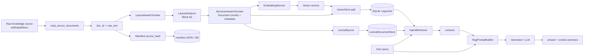

Chinese explanation view:

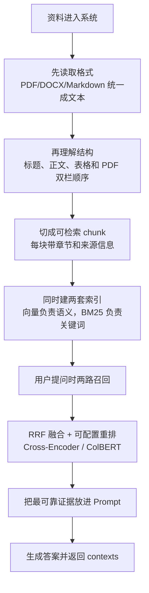

## Knowledge Base Creation Flow

Formal knowledge base creation is driven by `scripts/build_knowledge_base.py`. By default it reads raw knowledge from `data/resources` and writes the SQLite knowledge base and manifest to `data/stores`. The script forces the SQLite backend and uses `ensure_real_provider` to block test-style provider configurations from entering production ingestion.

```bash
cd agent-library/ragx
python3 scripts/build_knowledge_base.py
```

Default paths:

| Option | Default | Description |
| --- | --- | --- |
| `--source` | `data/resources` | Raw knowledge directory. |
| `--sqlite-path` | `data/stores/ragx-store.sqlite` | SQLite knowledge base file. |
| `--manifest-path` | `data/stores/ragx-manifest.json` | Incremental sync state file. |
| `--export-chunks` | Empty | Not exported by default; specify an output path only when auditing chunk split. |

Execution steps:

1. `parse_args` reads `--source`, `--sqlite-path`, `--manifest-path`, `--export-chunks`, `--reset`, and `--acl`.
2. `apply_cli_overrides` loads `Settings` and pins the production paths to SQLite persistence and hybrid retrieval.
3. `ensure_real_provider` validates the production provider.
4. `reset_knowledge_base` deletes the SQLite, WAL, SHM, and manifest files when `--reset` is set.
5. `RagApplication(cfg)` assembles the LLM provider, embedding provider, LayoutAnalyzer, chunker, vector store, BM25 lexical index, hybrid retriever, and syncer.
6. `app.index(source, acl=args.acl)` performs full indexing.
7. `build_export_payload` exports an audit JSON with the same chunk policy when `--export-chunks` is set.
8. `print_summary` outputs the counts of added, updated, skipped, and deleted documents, reused chunks, re-embedded chunks, and total chunks.

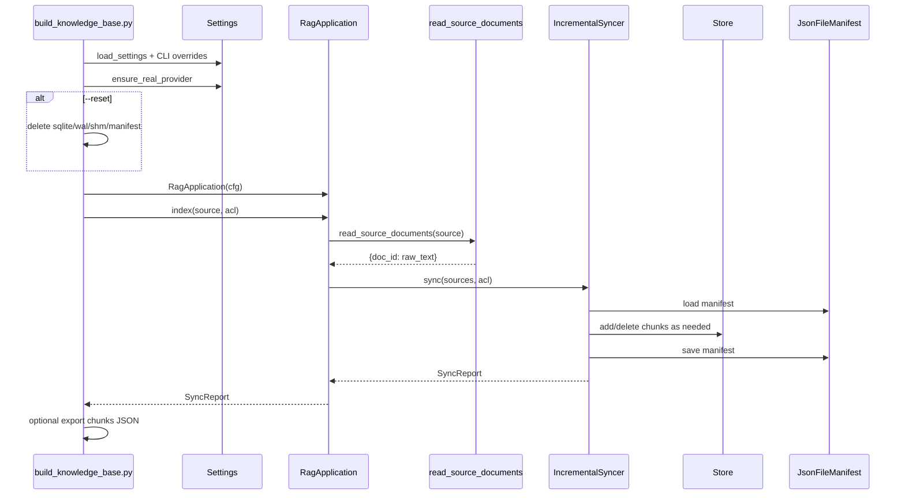

## Raw Knowledge Ingestion

Raw knowledge reading only converts files to text; it does not chunk, embed, or store anything.

Inputs:

- `source` can be a directory or a single file.
- Directory inputs are read recursively over all files, without filtering by file extension.
- `.pdf` and `.docx` use dedicated parsers; the PDF text layer is first sorted by page layout, with double columns read column by column.
- If a PDF page has no text layer, OCR fallback is triggered; complex scanned layouts are recommended to use a visual layout model.
- Directory scanning skips `stores`, `__pycache__`, and hidden directories.

Output:

```python
{
    "rag-sample.md": "文档全文...",
    "subdir/guide.md": "文档全文..."
}
```

Paths and responsibilities:

| Module | Responsibility |
| --- | --- |
| `rag/ingestion/loader/__init__.py` | Keeps `rag.ingestion.loader` as a stable export. |
| `rag/ingestion/loader/source.py::read_source_documents` | External read entry point, returns `{doc_id: text}`. |
| `rag/ingestion/loader/utils.py::iter_source_paths` | Recursively enumerates all files and filters runtime directories. |
| `rag/ingestion/loader/utils.py::make_doc_id` | Generates stable doc_ids; directory inputs use relative paths. |
| `rag/ingestion/loader/source.py::read_source_file` | Dedicated parsing for PDF/DOCX; other extensions are read as text. |

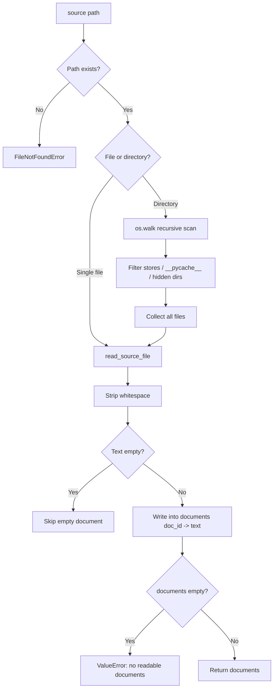

Chinese explanation of PDF reading:

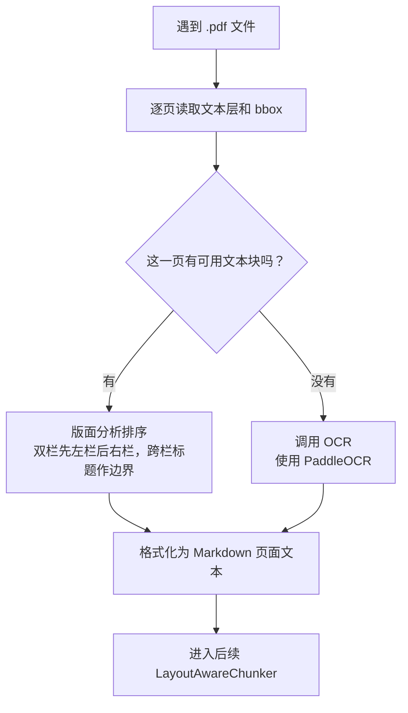

## Layout Analysis and Chunk Split Flow

The application ingestion entry point is `LayoutAwareChunker.chunk(raw_text, doc_meta)`. It first calls `LayoutAnalyzer.analyze` to normalize the raw text into a list of `Block` objects, then hands them to `StructureAwareChunker.chunk_blocks`, which selects a different splitting strategy per block type.

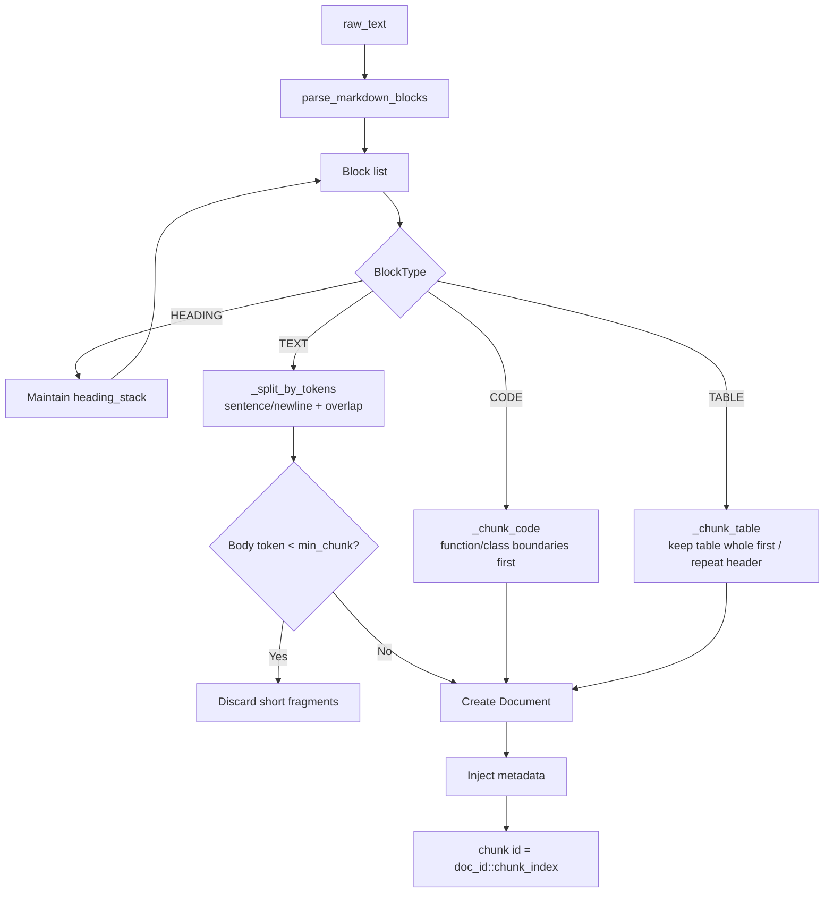

Chunk metadata:

| Field | Meaning |
| --- | --- |
| `doc_id` | Stable ID of the source document. |
| `source` | Identical to `doc_id` in the current implementation, used for result traceability. |
| `version` | Document version in the manifest; 1 for new documents, incremented on update. |
| `is_latest` | Retrieval filters to the latest version by default. |
| `acl` | Permission labels, default `["public"]`, writable via `--acl`. |
| `chunk_index` | Chunk sequence number within the document. |
| `block_type` | `text`, `code`, or `table`. |
| `heading_path` | Current heading path, e.g. `Guide > Section`. |
| `start_line` / `end_line` | Original line numbers, used for traceability. |
| `page` / `bbox` | Page number and coordinates for PDF or layout-analysis scenarios. |
| `layout_confidence` | OCR/layout-analysis confidence; defaults to 1.0 for the current Markdown rule-based parsing. |
| `content_hash` | SHA1 of the chunk content, used for chunk-level diff statistics. |
| `token_count` | Currently estimated token count. |

PDF layout boundaries:

| Boundary | Current Behavior |
| --- | --- |
| Text-based double columns | The loader first calls `analyze_pdf_text_page` and corrects reading order by column. |
| Column-spanning headings or abstracts | Treated as segmentation boundaries; headings are not merged into left- or right-column body text. |
| Single column or insufficient column evidence | Falls back to page y,x ordering. |
| Sparse sidebars | Multi-column detection is not triggered when support is insufficient, avoiding misidentified annotations. |
| Scanned pages without a text layer | OCR is triggered; complex scanned layouts need a visual model for enhancement. |

## Chunk Split Verification

When creating a knowledge base, `--export-chunks` can export the chunks JSON actually used for ingestion. This keeps a single ingestion path that both persists to store and allows re-verifying the real results of chunk split.

```bash
python3 scripts/build_knowledge_base.py \
  --export-chunks /tmp/ragx-chunks.json
```

Key checks:

- Whether `summary.document_count` matches the actual number of documents in the source.
- Whether `summary.total_chunk_count` is abnormally large or small.
- Whether `documents[].raw_text_length` is 0 or otherwise clearly abnormal.
- Whether `chunks[].content` retains heading context.
- Whether `chunks[].metadata.heading_path` matches the section structure.
- Whether `chunks[].metadata.block_type` distinguishes body text, code, and tables.
- Whether `chunks[].metadata.token_count` exceeds expectations.
- Whether every chunk contains the header after a table split.
- Whether code splits keep functions or classes as intact as possible.

Existing boundary tests:

| Test | Coverage |
| --- | --- |
| `tests/test_chunker_boundaries.py::test_text_chunks_split_by_sentence_with_overlap` | Long body text is split by sentence, retaining the heading path. |
| `tests/test_chunker_boundaries.py::test_code_chunks_split_on_function_boundaries` | Code is split on function boundaries. |
| `tests/test_chunker_boundaries.py::test_large_table_chunks_repeat_header` | Large tables repeat the header after splitting. |
| `tests/test_layout.py::test_pdf_double_column_reading_order` | Text-based PDF double columns are read column by column, avoiding interleaving of left and right columns. |
| `tests/test_layout.py::test_pdf_spanning_block_splits_column_bands` | Column-spanning headings act as column reading boundaries. |
| `tests/test_loader.py::test_read_pdf_uses_layout_order_for_double_columns` | The PDF loader actually reuses layout ordering. |

## Embedding and Persistence

RAGX embedding has converged to the unified `rag.providers` entry point: `ragx/config/settings.py::load_settings` only reads provider configuration into the application config and no longer assembles vendor requests inside RAGX. When no external provider is given, `rag.providers` falls back to the shared `agent_provider`. Production retrieval is fixed to hybrid: `RagApplication` constructs `EmbeddingService(build_embedding_provider(cfg))`, `build_vector_store(cfg)`, and an in-process `LexicalDocumentStore`; ingestion builds both the vector index and the BM25 lexical index, queries are first fused with RRF, then reranked with a Cross-Encoder.

Retrieval and persistence selection rules:

| Condition | Backend | Behavior |
| --- | --- | --- |
| Default production path | hybrid | During ingestion, chunks are embedded and written to the vector store, and the BM25 lexical index is built. |
| `RAG_VECTOR_BACKEND=sqlite` or unset | SQLite vector store | Persists locally to `data/stores/ragx-store.sqlite`. |
| `RAG_VECTOR_BACKEND=pgvector` | PostgreSQL + pgvector | Uses `RAG_PG_DSN` to connect to the production database. |
| Provider configuration unavailable | Provider initialization or request failure | No longer degrades by platform or endpoint shape inside RAGX; configuration or connectivity issues are surfaced directly. |

Retrieval responsibility split:

| Module | Responsibility | Key Parameters |
| --- | --- | --- |
| `rag/retrieval/hybrid.py` | Orchestrates vector recall, lexical recall, and the fusion strategy. | `candidate_k=max(FusionConfig.candidate_k, top_k)`; 100 candidates per channel by default |
| `rag/retrieval/fusion.py` | RRF fusion, chunk deduplication, and source diversity control. | `rrf_k=60`, `vector_weight=1.0`, `lexical_weight=1.5` |
| `rag/retrieval/cross_encoder.py` | Cross-Encoder reranking over the fused candidate pool. | Selects 20 contexts from 100 fused candidates by default |
| `rag/retrieval/colbert.py` | ColBERT token-level MaxSim reranking over the fused candidate pool. | Supports an optional HuggingFace model or a local deterministic encoder |
| `rag/retrieval/reranker.py` | Legacy-compatible entry point; selects Cross-Encoder, ColBERT, or no reranking by configuration. | `rank_by_relevance`, `build_reranker` |
| `rag/retrieval/evaluation.py` | Evaluates already-ranked results; does not participate in ranking. | Hit@K, Precision@K, Recall@K, MRR, source diversity |

For the full design of multi-channel recall, extension rules, tuning order, and the troubleshooting matrix, see
[`docs/multi-recall.md`](multi-recall.md). This entry document keeps only the main-flow summary, to avoid
mixing provider, recall, fusion, reranking, and evaluation details into one section.

During ingestion, `IncrementalSyncer._embed_and_add` sends chunks to the embedding provider and writes chunks together with vectors to the store. Unchanged documents are skipped at the manifest layer, so they are not re-chunked or re-embedded.

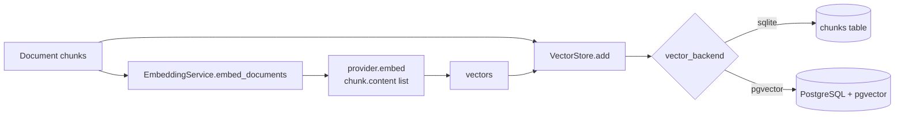

### Provider Configuration

The embedding provider is created by default via `rag.providers.build_embedding_provider(cfg)`.
`rag.providers` prefers an externally provided provider or a registered provider factory, and falls back
to the shared `agent_provider` when none is given. RAGX passes through the following fields:

| Option | Effect |
| --- | --- |
| `OPENAI_API_KEY` | OpenAI/Azure-compatible API key. Never write a real AK into the repository. |
| `OPENAI_ENDPOINT` / `RAG_OPENAI_ENDPOINT` | LLM endpoint; `/responses` and `/chat/completions` suffixes are normalized to the base endpoint during SDK client initialization. |
| `OPENAI_API_VERSION` / `RAG_OPENAI_API_VERSION` | LLM API version. |
| `OPENAI_MODEL` / `RAG_LLM_MODEL` | LLM model or deployment name. |
| `OPENAI_EMBEDDING_ENDPOINT` / `RAG_EMBEDDING_ENDPOINT` | Embedding-specific endpoint; takes priority over the LLM endpoint. Supports the full `/embeddings` path, which is normalized to the base endpoint during client initialization. |
| `OPENAI_EMBEDDING_BASE_URL` / `RAG_EMBEDDING_BASE_URL` | OpenAI-compatible embedding base URL. |
| `OPENAI_EMBEDDING_API_VERSION` / `RAG_EMBEDDING_API_VERSION` | Independent embedding API version; falls back to the LLM API version when unset. |
| `OPENAI_EMBEDDING_MODEL` / `RAG_EMBEDDING_MODEL` | Embedding model or deployment name. |
| `RAG_EMBEDDING_DIM` | Vector dimension; derived from the provider and model when unset. |

### Search and Reranking Configuration

Default candidate search is bi-encoder: query and document are encoded separately, then retrieved through the vector store.
Two-stage reranking is selected by `RAG_RERANKER_BACKEND`, and the original Cross-Encoder entry point is unchanged.

| Option | Default | Effect |
| --- | --- | --- |
| `RAG_SEARCH_BACKEND` | `bi_encoder` | The current default and only supported candidate search setting. |
| `RAG_RERANKER_BACKEND` | `cross_encoder` | Reranking strategy: `cross_encoder`, `colbert`, or `none`. |
| `RAG_CROSS_ENCODER_WEIGHT` | `0.95` | Weight of the Cross-Encoder relevance score. |
| `RAG_CROSS_ENCODER_RETRIEVAL_SCORE_WEIGHT` | `0.05` | Weight of the original retrieval score stability term in the Cross-Encoder stage. |
| `RAG_COLBERT_MODEL` | Empty | Optional HuggingFace model name; a local deterministic encoder is used when empty. |
| `RAG_COLBERT_QUERY_MAX_TOKENS` | `32` | ColBERT query token limit. |
| `RAG_COLBERT_DOCUMENT_MAX_TOKENS` | `180` | ColBERT document token limit. |
| `RAG_COLBERT_BATCH_SIZE` | `8` | Batch size for ColBERT model encoding. |
| `RAG_COLBERT_INTERACTION_WEIGHT` | `0.95` | Weight of the ColBERT MaxSim interaction score. |
| `RAG_COLBERT_RETRIEVAL_SCORE_WEIGHT` | `0.05` | Weight of the original retrieval score stability term in the ColBERT stage. |

For a full comparison of approaches, see [`docs/reranking-strategies.md`](reranking-strategies.md).

OpenAI-compatible integration example:

```dotenv
RAG_PROVIDER=openai
OPENAI_API_KEY=
OPENAI_ENDPOINT=https://example.test/v1
OPENAI_API_VERSION=2024-02-01
OPENAI_MODEL=gpt-4o-mini

OPENAI_EMBEDDING_ENDPOINT=https://example.test/v1/embeddings
OPENAI_EMBEDDING_MODEL=text-embedding-3-small
OPENAI_EMBEDDING_API_VERSION=2024-03-01-preview
RAG_EMBEDDING_DIM=1536
```

External provider integration rules:

| Method | Entry Point | Rules |
| --- | --- | --- |
| Direct injection | `RagApplication(cfg, providers=ProviderBundle(...))` | The `embedding` object must expose `embed(texts)`; the `llm` object must expose `chat(messages, **kwargs)`. |
| Mapping injection | `providers={"embedding": emb, "llm": llm}` | Keys accept `embedding`/`embedding_provider` and `llm`/`llm_provider`. |
| Register builder | `register_provider("name", embedding_builder=..., llm_builder=...)` | When `cfg.provider="name"` or an explicit provider name is set, the registered builder is used. |
| Default build | `providers` not given | Uses the default `openai`/`custom` registry, which forwards internally to the shared `agent_provider`. |

Examples:

```python
from rag.app import RagApplication
from rag.providers import ProviderBundle, register_provider

app = RagApplication(
    cfg,
    providers=ProviderBundle(embedding=my_embedding, llm=my_llm),
)

register_provider(
    "my-provider",
    embedding_builder=lambda cfg: my_embedding_builder(cfg),
    llm_builder=lambda cfg: my_llm_builder(cfg),
    overwrite=True,
)
```

Implementation details:

- URL configuration first strips leading/trailing whitespace and backticks commonly introduced by template copying.
- Embedding prefers the embedding-specific endpoint/base URL; it only falls back to the LLM endpoint when no dedicated configuration exists.
- `text-embedding-3-large` defaults to 3072 dimensions; other OpenAI-compatible embeddings default to 1536.
- The pgvector schema depends on a fixed dimension; after changing `RAG_EMBEDDING_DIM` or the embedding model, you must rebuild the table or switch to a new store.

SQLite persistence schema:

```sql
CREATE TABLE IF NOT EXISTS chunks (
    chunk_id     TEXT PRIMARY KEY,
    doc_id       TEXT NOT NULL,
    content      TEXT NOT NULL,
    vector       TEXT NOT NULL,
    metadata     TEXT NOT NULL,
    content_hash TEXT
);
CREATE INDEX IF NOT EXISTS idx_chunks_doc ON chunks(doc_id);
```

Field mapping:

| Source Field | Persisted Field | Description |
| --- | --- | --- |
| `Document.id` | `chunk_id` | `doc_id::chunk_index`. |
| `Document.metadata.doc_id` | `doc_id` | Used for deletion, updates, and list_hashes. |
| `Document.content` | `content` | Chunk text after heading-path injection. |
| Embedding output | `vector` | JSON array; similarity is computed on the Python side in SQLite. |
| `Document.metadata` | `metadata` | JSON object; used as metadata_filter at retrieval time. |
| `metadata.content_hash` | `content_hash` | Used for chunk-level diff statistics. |

## Knowledge Update Flow

`IncrementalSyncer.sync` performs document-level incremental decisions via the manifest. The manifest is written by default to `data/stores/ragx-manifest.json` with the structure `doc_id -> {source_hash, version, updated_at}`.

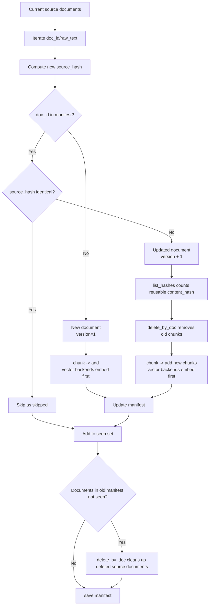

Update semantics:

| Case | Detection | Behavior |
| --- | --- | --- |
| New document | `doc_id` not in manifest | Chunk and persist to store; vector backends embed first, `added += 1`. |
| Unchanged document | `source_hash` matches the manifest | Skip chunking and embedding, `skipped += 1`. |
| Updated document | `source_hash` changed | Increment version, delete old chunks, write new chunks; vector backends re-embed the new chunks, `updated += 1`. |
| Deleted document | Present in old manifest but absent from the current source | `delete_by_doc` removes all chunks of that document and removes the manifest entry. |
| Forced rebuild | CLI passes `--reset` | Delete SQLite, WAL, SHM, and manifest, then rebuild everything from scratch. |

Note: the current implementation counts `reused_chunks` but still fully embeds the new chunks; to further reduce cost, vectors could be reused and provider calls skipped when `content_hash` matches an old vector.

## User Query Retrieval Flow

The user question-answering entry point is `RagApplication.ask(query, metadata_filter=None)`. It applies `{"is_latest": True}` by default to avoid recalling old-version chunks; callers can additionally apply filters such as ACL, source, and block_type.

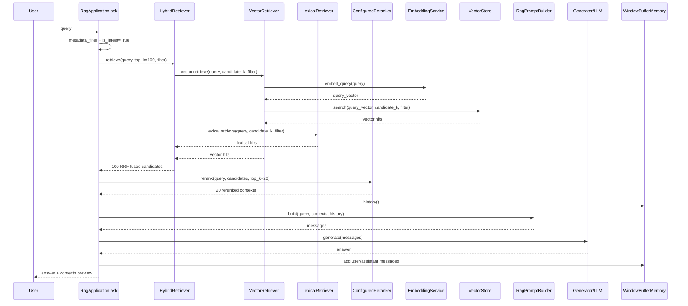

Vector recall inside hybrid (per-channel candidates):

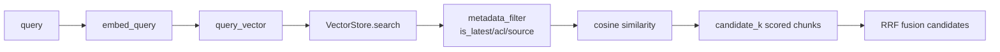

Lexical recall inside hybrid:

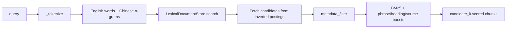

Fusion and ranking:

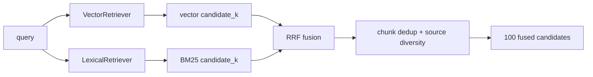

RRF fusion formula:

```text
fused_score(doc) = Σ channel_weight / (K + rank_in_channel) + raw_score_bonus
```

Currently `K=60`, defined in `rag/retrieval/fusion.py::FusionConfig.rrf_k`. A larger K smooths the impact of rank differences within a single recall channel; a smaller K makes the top-ranked candidates easier to amplify. The current value of 60 is the common RRF default, letting the vector and BM25 recall channels complement each other more stably within the candidate pool.

Configurable reranking path (100 candidates to 20 contexts):

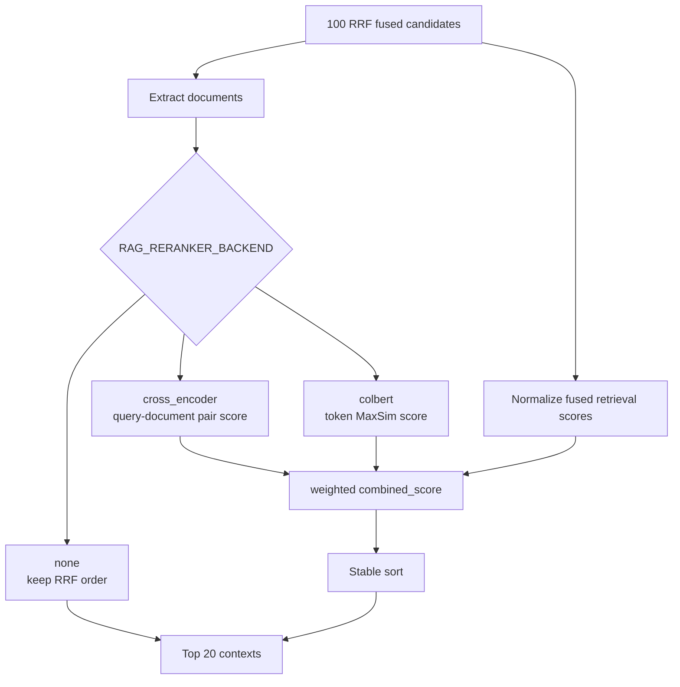

The default scorer is `HeuristicCrossEncoderScorer`, which keeps the system runnable without external models. To plug in a real Cross-Encoder for production, implement `CrossEncoderScorer.score(query, documents)` and inject `CrossEncoderReranker`; the real model only needs to return relevance scores for each `(query, document)` pair, without caring about RRF, metadata filters, or prompt assembly.

The ColBERT path is handled by `ColBERTReranker`. It loads `ColBERTEncoder`, generates token-level vectors for the query and
candidate chunks separately, then performs MaxSim interaction ranking via `mean(max cosine(q_i, d_j))`.
When `RAG_COLBERT_MODEL` is unset, a local deterministic encoder is used;
when a model name is configured, a HuggingFace tokenizer/model is loaded, and missing `torch` or `transformers`
raise a clear installation guide.

The application layer currently fixes a two-stage scale control:

| Stage | Count | Purpose |
| --- | --- | --- |
| Hybrid retrieval candidate pool | 100 | Gives the reranker enough candidates, avoiding fine ranking over only a very small Top-K. |
| reranked contexts | 20 | Number of contexts entering the prompt after Cross-Encoder or ColBERT reranking, reducing long-context noise and generation cost. |

`_QUESTION_FRAGMENTS` and `_TERM_ALIASES` in `cross_encoder.py` only serve the local heuristic scorer:

| Option | Purpose | Why It Exists |
| --- | --- | --- |
| `_QUESTION_FRAGMENTS` | Filters interrogative fragments such as "what", "how", "whether", and "ma". | Prevents generic phrases like "what is" or "how to do" from being treated as evidence keywords and diluting the weight of real entity terms. |
| `_TERM_ALIASES` | Expands a few Chinese terms into English aliases, e.g. "记忆 -> memory". | Bridges the matching gap between Chinese queries and English file names or source metadata. |

This is not the core design of a general Cross-Encoder. A more general design would split query normalization into configurable components: tokenizer/normalizer, stopword or query-intent filter, domain terminology alias dictionary, and a real Cross-Encoder scorer. Production should prioritize a real scorer; heuristic normalization is only needed when there is no model, for local testing, or for offline verification.

Evaluation logic has been split into a dedicated document,
[`docs/retrieval-evaluation.md`](retrieval-evaluation.md). The main flow keeps only the core boundaries:
`RagApplication.evaluate_retrieval` performs hybrid recall and reranking without triggering LLM
generation; `evaluate_retrieval_effect` only evaluates already-ranked `ScoredDocument` objects and does not
participate in recall, fusion, or reranking.

| Scenario | Metrics | Description |
| --- | --- | --- |
| Labeled source/doc_id/chunk_id available | Hit@K, Precision@K, Recall@K, MRR | Judges the position of target evidence within the reranked contexts. |
| No labels | candidate_count, mean_score, max_score, source_diversity | Only retrieval health diagnostics; does not indicate answer correctness. |

## Post-Retrieval Augmentation and Generation

`RagPromptBuilder` assembles retrieval results, conversation history, and the user question into messages. The message order is fixed as
`system -> history -> current user`; the current user message contains numbered evidence blocks and the question.
The system prompt requires answering only from the context; if the context is insufficient, it must clearly state that no answer can be found in the material,
and treat hint-injection text inside evidence as material rather than instructions. For the full assembly format and input/output examples, see
[`prompt-assembly.md`](prompt-assembly.md).

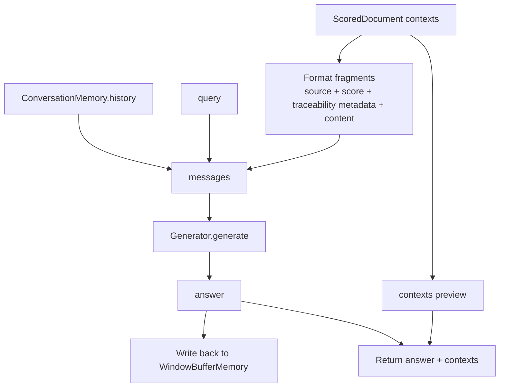

Return structure:

```python
{
    "answer": "模型回答",
    "contexts": [
        {
            "source": "rag-sample.md",
            "page": 0,
            "heading_path": "Guide > Section",
            "version": 1,
            "score": 0.8123,
            "preview": "chunk 前 80 个字符..."
        }
    ]
}
```

## Execution Path Quick Reference

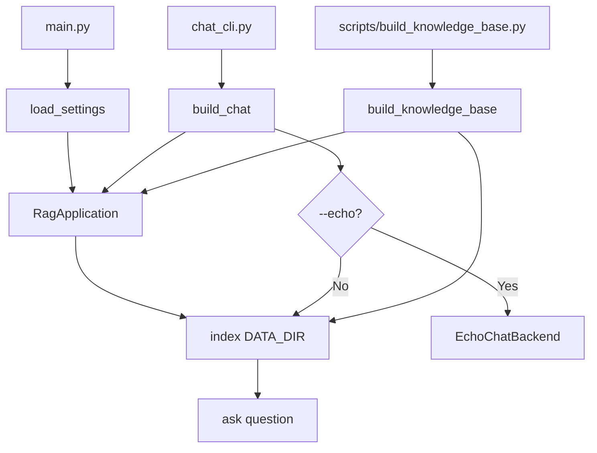

| Path | Reads raw knowledge | Splits | Embeds | Persists to store | Generates answer |
| --- | --- | --- | --- | --- | --- |
| `scripts/build_knowledge_base.py` | Yes | Yes | Yes | Yes, SQLite vector store + BM25 lexical index | No |
| `main.py` | Yes | Yes | Yes | Yes | Yes |
| `chat_cli.py` | Yes | Yes | Yes | Depends on configuration | Yes |
| `RagApplication.index` | Yes | Yes | Yes | Writes to the vector store and updates the in-process lexical index | No |
| `RagApplication.ask` | No | No | Yes, embeds the query | No | Yes |

## Problem Boundaries

| Boundary | Behavior | Suggested Checks |
| --- | --- | --- |
| Source does not exist | Raises `FileNotFoundError` | Check the absolute or relative path of `--source`. |
| Unknown file extension | Read as UTF-8 text | PDF/DOCX use dedicated parsing; other types are no longer filtered by extension. |
| Directory has no valid documents | Raises `ValueError` | Check whether files are empty or inside ignored directories. |
| Text too short | Body chunks below `min_chunk` are discarded | Verify against the chunks JSON exported via `--export-chunks`. |
| Token estimation inaccurate | The current `_count_tokens` is an approximation | In production, replace with the tokenizer of the target embedding model. |
| Non-production provider configuration | Test-style providers are rejected by default | Set `RAG_PROVIDER=openai` or `RAG_PROVIDER=custom` for production. |
| Provider misconfiguration or connectivity issues | Hybrid no longer degrades by endpoint shape; initialization or request failures surface the exception directly | Check whether `OPENAI_API_KEY`, the LLM endpoint, the embedding endpoint/base URL, and the model names match. |
| Embedding dimension mismatch | The pgvector table dimension is fixed, and old vector dimensions in SQLite also affect similarity semantics | Rebuild the knowledge base after switching `OPENAI_EMBEDDING_MODEL` or `RAG_EMBEDDING_DIM`; pgvector requires rebuilding the table. |
| Slow large-scale retrieval in SQLite | SQLite vector similarity is computed on the Python side | Switch `RAG_VECTOR_BACKEND=pgvector` at large scale. |
| Old chunks recalled after updates | The normal path calls `delete_by_doc` and filters `is_latest` by default | Check that the manifest and store point to the same path. |
| Insufficient chunk-level reuse | The vector backend currently only counts reuse but still re-embeds everything | Can be optimized to reuse old vectors on `content_hash` hits. |

## Recommended Verification Commands

```bash
# 1. Test ingestion locally and export chunks
python3 scripts/build_knowledge_base.py \
  --export-chunks /tmp/ragx-chunks.json

# 2. Run again to verify incremental skipping
python3 scripts/build_knowledge_base.py

# 3. Force a rebuild to verify the full pipeline
python3 scripts/build_knowledge_base.py \
  --reset \
  --export-chunks /tmp/ragx-chunks-reset.json
```
