# RAGX Layout Analysis to Retrieval-Generation Pipeline

This document describes the complete production pipeline in `ragx`: "layout analysis -> structure-aware chunking -> incremental sync -> retrieval/generation". It focuses on module responsibilities, data structures, metadata propagation, version consistency, and troubleshooting, to help maintain knowledge base construction, retrieval quality, and generation results.

## Abbreviations

| Abbreviation | Full Name | Description |
| --- | --- | --- |
| ACL | Access Control List | Access control list, used for retrieval filtering. |
| BM25 | Best Matching 25 | Lexical relevance ranking function. |
| CJK | Chinese, Japanese, and Korean | Chinese, Japanese, and Korean character set. |
| DOCX | Office Open XML Wordprocessing Document | Word document format. |
| JSON | JavaScript Object Notation | Structured data interchange format. |
| LLM | Large Language Model | Large language model. |
| MRR | Mean Reciprocal Rank | Mean reciprocal rank. |
| OCR | Optical Character Recognition | Optical character recognition. |
| PDF | Portable Document Format | Portable document format. |
| RAG | Retrieval-Augmented Generation | Retrieval-augmented generation. |
| RRF | Reciprocal Rank Fusion | Reciprocal rank fusion. |

See [RAGX Abbreviations](abbreviations.md) for the full abbreviations table. The latest PaddleOCR version verified against PyPI is `3.7.0`.

## 1. Overview

The application entry point of RAGX is `rag.app.RagApplication`. It is the Composition Root, responsible for wiring together configuration, providers, layout analysis, chunking, vector store, lexical index, hybrid retrieval, reranking, prompt construction, and Large Language Model (LLM) generation. This document also records the key implementation details of chunking, Reciprocal Rank Fusion (RRF), rerankers, and evaluation metrics.

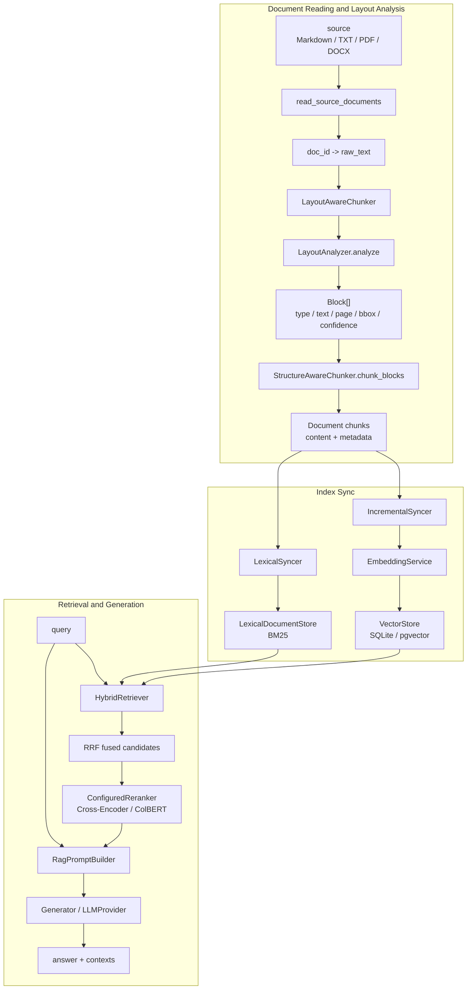

Chinese explanation view:

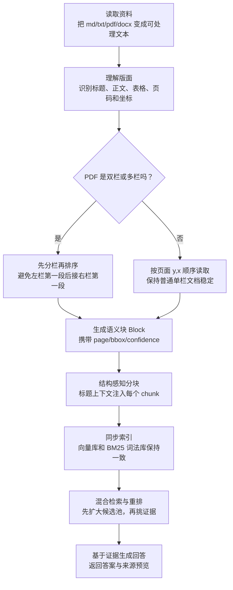

Key implementation paths:

| Stage | Modules | Responsibility |
| --- | --- | --- |
| Configuration and Providers | `config/settings.py`, `agent_provider` | Read provider, embedding, vector store, and chunking parameters. |
| Raw document reading | `rag/ingestion/loader/source.py` | Read a directory or files into `{doc_id: raw_text}`. |
| Layout analysis | `rag/ingestion/layout.py` | Normalize text or pages into a `Block` list. |
| Structure-aware chunking | `rag/ingestion/chunker.py` | Generate indexable `Document`s from headings, text, code, and tables. |
| Incremental sync | `rag/ingestion/sync.py` | Use the manifest to determine additions, updates, deletions, and skips. |
| Vector index | `rag/embedding/service.py`, `rag/vectorstore/*` | Embed chunks and write them into the vector store. |
| Lexical index | `rag/retrieval/lexical.py` | Build the BM25 inverted index. |
| Hybrid retrieval | `rag/retrieval/hybrid.py`, `rag/retrieval/fusion.py` | Vector recall + lexical recall + RRF fusion. |
| Reranking | `rag/retrieval/reranker.py`, `rag/retrieval/cross_encoder.py`, `rag/retrieval/colbert.py` | Rank fused candidates with Cross-Encoder, ColBERT, or no-op according to configuration. |
| Generation | `rag/augmentation/prompt_builder.py`, `rag/generation/generator.py` | Assemble context, history, and question, call the LLM, and return the answer. |

## 2. Layout Analysis

The unified contract of the layout analysis layer is `Block`. Regardless of whether the upstream source is Markdown rule parsing, text-based PDF coordinate clustering, OCR, a visual layout model, or future HTML body extraction, the downstream only consumes this one structure.

```python
Block(
    type=BlockType.TEXT,
    text="正文内容",
    level=0,
    start_line=10,
    end_line=15,
    page=1,
    bbox=(10.0, 20.0, 400.0, 90.0),
    confidence=0.98,
)
```

Field meanings:

| Field | Description |
| --- | --- |
| `type` | `heading`, `text`, `code`, `table`, `image`. |
| `text` | Normalized block text. |
| `level` | Heading level; only meaningful for `heading`. |
| `start_line` / `end_line` | Source line numbers in the text. |
| `page` | Page number of the PDF or paginated document; 0 when there is no pagination. |
| `bbox` | Page coordinates `(x0, y0, x1, y1)`, used for source highlighting or click-to-jump. |
| `confidence` | Layout detection or OCR confidence; defaults to 1.0 for rule parsing. |

The current implementation includes three analyzers:

| Analyzer | Input | Output | Current Use |
| --- | --- | --- | --- |
| `MarkdownLayoutAnalyzer` | Markdown or plain-text content | `Block[]` | Used by the default production pipeline; zero dependencies. |
| `PdfTextLayoutAnalyzer` | PDF path | `Block[]` with page numbers and bbox | For text-based PDFs, detects two-column/multi-column layouts per page and outputs a stable reading order. |
| `ModelLayoutAnalyzer` | PDF or image path | `Block[]` | Skeleton for visual model integration; raises `NotImplementedError` by default. |

`RagApplication` currently chains them explicitly through `LayoutAwareChunker`:

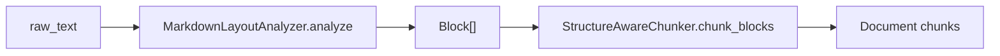

Chinese explanation view:

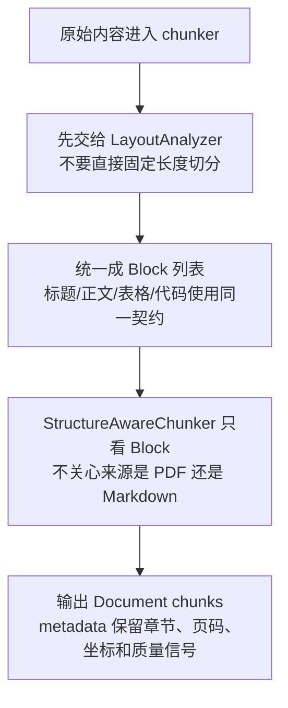

The point of this design is to make layout analysis an independent, replaceable node. The default chunking path keeps the stable behavior of Markdown/plain-text rule parsing; the PDF loader already reuses `analyze_pdf_text_page` to correct the two-column reading order of text-based PDFs. In the future, when PDF bboxes need to be passed through directly into indexed chunks, only the loader or syncer needs to pass richer Blocks — the retrieval and generation pipeline requires no changes.

### 2.1 PDF Two-Column and Boundary Handling

The reading order of text-based PDFs is handled by `rag/ingestion/layout.py::analyze_pdf_text_page`. After obtaining text blocks and bboxes from PyMuPDF's `get_text("dict")`, it does not blindly trust the default output order; instead it performs per-page column detection and reading-order sorting.

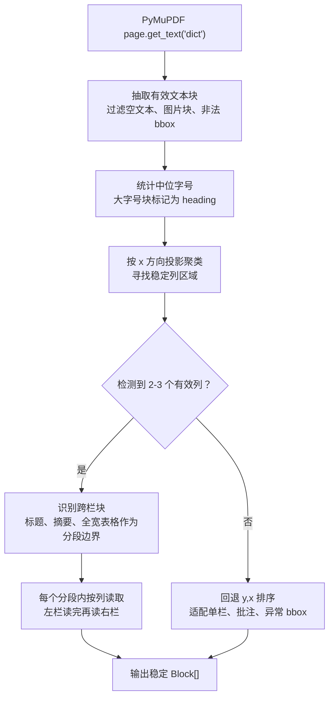

Chinese explanation view:

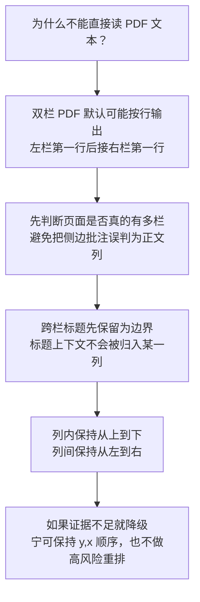

Boundary cases and current behavior:

Details of the two-column detection criteria:

| Criterion | Current Threshold or Condition | Purpose |
| --- | --- | --- |
| Minimum candidate blocks | Fall back to single column directly when candidate text blocks `< 4` | A small amount of text is insufficient to prove stable column layout. |
| Candidate block type | Exclude `HEADING` | Headings have large font sizes and often span columns; they cannot serve as evidence of body-text columns. |
| Candidate block text length | `len(text) >= 2` | Filter out page numbers, isolated symbols, and noise. |
| Candidate block width | `bbox_width <= page_width * 0.62` | Wide blocks are most likely spanning headings, abstracts, full-width paragraphs, or tables. |
| Horizontal clustering gap | `max(page_width * 0.035, 18px)` | A new column is only created when the horizontal whitespace between adjacent blocks is large enough. |
| Column count | `2 <= column_count <= 3` | Support two columns and a small number of three-column layouts; fall back for table-like multi-column or anomalous layouts. |
| Column support | Each column must contain multiple blocks, or its text volume must reach `max(40, max_chars * 0.18)` | Prevent sparse sidebars, annotations, or footnotes from being misjudged as body-text columns. |
| Spanning block detection | Block width `>= page_width * 0.62`, or the block covers multiple column regions simultaneously | Used to identify headings, abstracts, cross-column sections, or full-width figure captions. |

The algorithm can be understood as "horizontal projection + support verification":

1. Extract text blocks from PyMuPDF's `page.get_text("dict")`, keeping `(x0, y0, x1, y1)`.
2. Discard image blocks, empty-text blocks, invalid bboxes, heading blocks, and overly wide blocks, keeping only candidates that may belong to body-text columns.
3. Iterate over candidates in ascending `x0`; if the distance between the current block's `x0` and the previous cluster's `x1` exceeds the gap threshold, create a new column cluster.
4. For each column cluster, accumulate its `x0/x1` range, block count, and character count.
5. If the column count is not 2-3, or any column lacks sufficient text support, the page is not considered multi-column.
6. For non-spanning blocks, assign them to the nearest column by bbox center; for spanning blocks return `-1`, marking a reading-segment boundary.
7. Between each pair of spanning boundaries, sort by column index left to right, and within each column by `y,x`. When there are no spanning blocks, the whole page is sorted by column.

This design is deliberately conservative: multi-column reading order is only activated when the evidence is strong enough. The reason is that a false positive of two-column detection usually causes more damage than a false negative. With a false negative, at worst the PDF's default `y,x` order is kept; with a false positive, margin notes, table columns, or footnotes get inserted into the main body line, breaking chunk semantics and polluting embeddings, BM25, and the reranker.

| Boundary | Current Handling | Description |
| --- | --- | --- |
| Text-based two-column layout | Detect 2-3 valid columns, sort by y,x within each column | Fixes row-by-row interleaving of left and right columns. |
| Spanning headings/abstracts/full-width paragraphs | Identified as spanning blocks and used as segment boundaries | Keeps headings before their corresponding sections. |
| Single-column PDFs | Fall back to y,x ordering when column detection is inconclusive | No additional reranking risk is introduced. |
| Sparse sidebars or margin annotations | Two-column detection not triggered when column support is insufficient | Prevents annotations from being treated as right-column body text. |
| Scanned PDFs or PDFs without a text layer | `read_pdf` falls back to OCR | OCR only returns text; complex layouts should integrate `ModelLayoutAnalyzer`. |
| Tables or multi-column lists | Fall back to y,x ordering when more than 3 horizontal clusters | Prevents table columns from being misjudged as page columns. |
| Rotated text, overlapping bboxes, headers/footers | Currently no aggressive removal; anomalous bboxes are filtered | For strongly formatted documents, a visual model or LayoutReader should be used. |

## 3. Structure-Aware Chunking

Structure-aware chunking is performed by `StructureAwareChunker`. Instead of hard-splitting by a fixed character count, it first maintains a heading stack and then selects a strategy per block type.

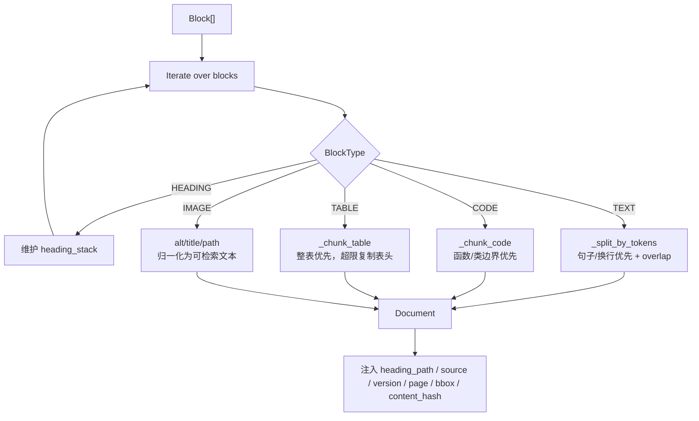

Chunking strategies:

| Type | Strategy | Purpose |
| --- | --- | --- |
| Headings | Do not generate chunks; only maintain `heading_path` | Gives subsequent body text, tables, and code section context. |
| Body text | Greedy packing by sentences and line breaks, with overlap retained | Reduces boundary truncation and avoids fixed-length splits breaking semantics. |
| Code | Split preferentially at boundaries such as `def`, `class`, and `function` | Preserve the integrity of functions, classes, or methods as much as possible. |
| Tables | Keep tables whole when possible; replicate the header in each shard when over the limit | Prevents table rows from becoming unintelligible after being separated from column names. |
| Images/Charts | Standalone Markdown image syntax normalizes alt, title, and path into an `image` chunk | Lets captions, legends, and file names enter embedding/BM25; the original visual content still requires a visual model extension. |

INFO logs are emitted when image/chart chunks are generated, making it easy to verify that alt, title, and path are preserved correctly. The logs come from `rag.ingestion.chunker`:

```text
image chunk generated: doc_id=report.md chunk_index=0 heading_path='Report' content='[Report]\n图片/图表: 季度 GMV 趋势图\n标题: Q4 GMV\n路径: charts/gmv.png'
```

If the runtime environment does not show INFO logs by default, enable them at the debug entry point:

```python
import logging

logging.basicConfig(level=logging.INFO)
```

The generated chunk content injects the heading path at the front of the body:

```text
[制度 > 报销]
出差报销需在 7 天内提交相关凭证...
```

This serves two goals at once:

- At the embedding stage, section semantics are visible, improving recall quality.
- When generating and returning contexts, `heading_path` can be displayed for provenance and manual review.

Core metadata:

| Field | Source | Use |
| --- | --- | --- |
| `doc_id` | Generated by the loader | Document-level deletion, update, and manifest primary key. |
| `source` | Currently identical to `doc_id` | Returned to the user for source display. |
| `version` | Manifest version | Distinguishes new from old versions after a document update. |
| `is_latest` | Written during sync | Queries filter to the latest version by default. |
| `acl` | `index(..., acl=...)` or CLI `--acl` | Permission filtering. |
| `chunk_index` | Incremented by the chunker | Positioning within a document. |
| `block_type` | `Block.type` | Allows filtering by body text, code, tables, or images/charts. |
| `heading_path` | Heading stack | Section provenance and recall enhancement. |
| `start_line` / `end_line` | `Block` | Line number positioning in text files. |
| `page` / `bbox` | `Block` | Positioning in PDF/image sources. |
| `layout_confidence` | `Block.confidence` | OCR/layout quality diagnostics. |
| `content_hash` | SHA1 of the chunk text | Chunk-level diffing and reuse statistics. |
| `token_count` | Estimated token count | Chunking quality auditing. |

### 3.1 Document Splitting Principles

RAGX's goal for document splitting is not "make every chunk the same length", but "make every chunk as understandable as possible without surrounding context". The splitting strategy follows these priorities:

1. **Structural boundaries take precedence over length boundaries**: headings, paragraphs, code blocks, and table blocks are preserved first; token limits are considered afterwards.
2. **Context anchors must be injected into chunks**: `heading_path` is written into both chunk content and metadata, so that references like "该指标" or "如下表" do not lose their antecedents.
3. **Local integrity first**: avoid cutting off functions and classes in code; avoid splitting table headers away from tables; avoid scrambling the page reading order of PDF text.
4. **Boundary overlap serves recall, not storage integrity**: body-text shards may overlap to reduce the chance of missing an answer that sits exactly on a boundary; metadata is still recorded independently per chunk.
5. **Chunk-level hashes are the basis for diffing**: `content_hash` should represent the chunk content that actually enters the index, not the original paragraph content.

Impact of splitting granularity on recall and generation:

| Granularity | Recall Impact | Generation Impact | Typical Risk |
| --- | --- | --- | --- |
| Too small | Exact hits are easy but semantics are incomplete; embeddings may only see fragments | The LLM needs to stitch multiple contexts together to answer | Recall@K drops when the answer spans chunks. |
| Moderate | Balances semantics and exact terms | Each piece of evidence in the prompt carries an independent meaning | Recommended default state. |
| Too large | More noise per chunk; vector similarity gets diluted | High prompt token cost; key sentences may be drowned out | Precision@K and NDCG@K drop. |

Recommended tuning approach:

| Parameter or Signal | When Increased | When Decreased | Metrics to Watch |
| --- | --- | --- | --- |
| `chunk_size` | More complete semantics; fewer chunks | Finer recall; more precise source positioning | Recall@K, Precision@K, prompt token count. |
| `chunk_overlap` | Fewer boundary misses | Less index bloat; fewer duplicate evidence items | duplicate context ratio, source diversity. |
| `min_chunk` | Less short-sentence noise | Short facts under headings are more easily indexed | Hit@1, Precision@1, empty-recall rate. |
| `heading_path` injection | Stronger section semantics | Shorter chunk text | MRR, NDCG@K, metadata hit ratio. |

### 3.2 Splitting Special Document Types

| Document Type | Splitting Strategy | Quality Checks |
| --- | --- | --- |
| Markdown / TXT | Rule parsing of headings, code fences, tables, standalone image syntax, and paragraphs | Does `heading_path` match the TOC hierarchy; are table headers preserved; do image alt/title/path make it into `image` chunks. |
| PDF text layer | Generate ordered `Block[]` per page first, then perform structural chunking | Are two columns read left then right; are `page/bbox` passed through. |
| DOCX | The loader converts to processable text and enters the same chunker | Are heading styles converted to headings; are tables degraded into readable text. |
| Code documents | Split preferentially at function/class boundaries | Does a single chunk preserve the signature, comments, and body. |
| Table-dense documents | Tables as standalone blocks, replicating headers in shards when necessary | Can each shard still be interpreted in terms of column meanings. |
| Image-based charts | Currently only Markdown alt/title/path or OCR-visible text is indexed | If bar charts, line charts, or flowcharts need semantic understanding, `ModelLayoutAnalyzer` should be integrated to generate chart summaries. |

### 3.3 Chunking Failure Modes

| Symptom | Root Cause | Fix Direction |
| --- | --- | --- |
| The correct document is recalled but the context does not contain the answer | Chunks too large, relevant sentences diluted; or chunks too small, answer spans boundaries | Adjust `chunk_size` / `overlap`; inspect exported chunks. |
| BM25 hits the file name but the wrong body text | Heading or source metadata weighted too strongly; body-text terms weak | Add body-text relevance checks or let the reranker suppress it. |
| Correct evidence disappears after reranking | Candidate pool too small, or chunks lack query terms | Increase `candidate_k`; add heading/source context. |
| LLM answers cite inconsistently | Multiple duplicate chunks from the same source | Adjust the source diversity penalty or merge duplicate contexts. |
| PDF text order scrambled | Two columns not detected, anomalous bboxes, or scanned files only going through OCR text | Inspect `analyze_pdf_text_page` output; integrate a visual model if needed. |

## 4. Incremental Sync

Incremental sync is performed by `IncrementalSyncer.sync(sources, acl=...)`. The input is `{doc_id: raw_text}` and the output is a `SyncReport`.

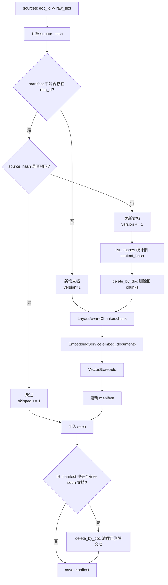

Sync semantics:

| Scenario | Decision | Behavior |
| --- | --- | --- |
| New document | `doc_id` does not exist | Chunk, embed, write to store; `added += 1`. |
| Unchanged document | `source_hash` identical | No chunking or embedding; `skipped += 1`. |
| Updated document | `source_hash` changed | Version incremented, old chunks deleted, then new chunks written. |
| Deleted document | Present in the manifest but absent from this sync's sources | Delete all chunks of the document and remove it from the manifest. |
| Forced rebuild | CLI `--reset` | Delete SQLite, WAL, SHM, and the manifest, then rebuild. |

The goal of `delete-then-insert` is to eliminate orphan vectors. Application-level queries also default to `is_latest=True`, so even if the model later switches to a soft-delete scheme that keeps historical versions, old versions can still be kept out of normal Q&A.

Note: `content_hash` is currently used for `reused_chunks` statistics, but the implementation still fully embeds new chunks. A further optimization would let the vector store reuse old vectors based on `content_hash`, skipping provider calls for unchanged chunks.

## 5. Hybrid Retrieval

The query entry point is `RagApplication.ask(query, metadata_filter=None)`. The application layer appends by default:

```python
metadata_filter = {"is_latest": True, **(metadata_filter or {})}
```

Callers may continue to pass:

```python
app.ask(
    "报销材料几天内提交？",
    metadata_filter={"acl": "finance", "source": "expense-rule.md"},
)
```

Retrieval has three stages: vector recall, lexical recall, and RRF fusion.

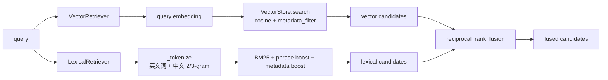

Complementarity of the two recall channels:

| Channel | Strengths | Weaknesses |
| --- | --- | --- |
| Vector recall | Semantic similarity, paraphrasing, questions worded differently from the document | Not always reliable for identifiers, proper nouns, or short code tokens. |
| Lexical recall | Exact terms, file names, headings, proper nouns, phrases | Weak on synonymous paraphrases and implicit semantics. |

RRF fusion does not add raw scores directly; it works on ranks:

```text
fused_score(doc) = Σ channel_weight / (rrf_k + rank_in_channel) + raw_score_bonus
```

Current default parameters:

| Parameter | Default | Description |
| --- | --- | --- |
| `candidate_k` | 100 | Size of each channel's candidate pool. |
| `rrf_k` | 60 | RRF smoothing parameter. |
| `vector_weight` | 1.0 | Vector channel weight. |
| `lexical_weight` | 1.5 | Lexical channel weight, boosting exact-term hits. |
| `source_diversity_penalty` | Defined in configuration | Reduces many duplicate candidates from the same source. |

<!-- retrieval-details-anchor -->

### 5.1 Vector Recall

Vector recall addresses the problem of "the question and the document wording do not match". The query is first converted into a query vector via `EmbeddingService`, then `VectorStore.search` computes similarity. The SQLite backend currently uses Python-side cosine similarity:

```text
cosine(q, d) = dot(q, d) / (||q|| * ||d||)
```

Key constraints of vector recall:

| Constraint | Description |
| --- | --- |
| Consistent embedding dimensions | `embedding_dim` must match the vector store schema; especially strict for pgvector. |
| Same model for query/doc | Indexing and querying must use the same embedding model or a compatible one. |
| Metadata filter applied first | Filters such as `is_latest`, `acl`, and `source` must take effect before candidates enter fusion. |
| Chunk content must carry context | Without a heading path, short chunks produce unstable semantic vectors. |

Common failure modes of vector recall:

- The document uses a proper noun while the user uses an abbreviation or identifier; the embedding may not reliably match.
- When chunks are too long, the vector signal of key sentences is diluted by other content.
- When chunks are too short, the vector represents only a local fragment, lacking business entities and section anchors.

### 5.2 Lexical Recall

Lexical recall is implemented by `LexicalDocumentStore`, using BM25 with phrase and metadata boosts. Chinese text does not rely on an external tokenizer; instead it uses English word splitting + Chinese 2/3-grams:

| Text | Example Terms |
| --- | --- |
| `RAG 报销` | `rag`, `报销` |
| `体验治理` | `体验`, `治理`, `体验治`, `验治理`, `体验治理` |

Base BM25 formula:

```text
score(q, d) = Σ IDF(t) * (tf(t,d) * (k1 + 1)) / (tf(t,d) + k1 * (1 - b + b * |d| / avgdl))

IDF(t) = log(1 + (N - df(t) + 0.5) / (df(t) + 0.5))
```

Current implementation parameters:

| Parameter | Default | Description |
| --- | --- | --- |
| `BM25_K1` | 1.5 | Controls the term-frequency saturation rate. |
| `BM25_B` | 0.75 | Controls the strength of document-length normalization. |

On top of BM25, the following are applied:

| Compensation | Effect |
| --- | --- |
| phrase boost | Adds score when a query phrase appears in body text, headings, or the source, protecting proper nouns, phrases, and Chinese segments. |
| metadata boost | Adds score when `heading_path` or `source` matches query terms, improving the interpretability of headings and file names. |
| metadata filter | Uses the same filtering rules as vector recall, so both channels see the same permissions and versions. |

### 5.3 RRF Fusion

The core value of RRF is avoiding the direct addition of scores on different scales. Vector similarity, BM25, and metadata boosts have different numeric ranges; adding them linearly lets one channel run out of control on different datasets. RRF only depends on within-channel ranks, which makes it more stable.

The production fusion score has three parts:

```text
base_rrf(doc) = Σ channel_weight(c) / (rrf_k + rank_c(doc))

raw_bonus(doc) = Σ channel_weight(c) * raw_score_weight * normalized_raw_score_c(doc)

fusion_score(doc) = base_rrf(doc) + raw_bonus(doc)
```

Where:

| Symbol | Meaning |
| --- | --- |
| `rank_c(doc)` | The document's 1-based rank in channel `c`'s recall results. Contributes nothing if absent from that channel. |
| `rrf_k` | Smoothing constant; larger values weaken rank differences. Default 60. |
| `channel_weight(c)` | Channel weight; currently vector 1.0, lexical 1.5. |
| `normalized_raw_score_c` | The channel's raw score normalized by the maximum absolute value within that channel. |
| `raw_score_weight` | Raw-score compensation weight, default 0.05. |

After RRF, chunk deduplication and source diversity control are applied:

```text
adjusted_score = fusion_score - source_diversity_penalty * already_selected_count(source)
```

This does not change the chunk's original `score` field; it only affects candidate selection order. The goal is to prevent several adjacent chunks of one source from monopolizing Top-K, giving the prompt a chance to cover more sources. Note that source diversity is a lightweight heuristic and should not replace ACL, version filtering, or business-category filtering.

### 5.4 Hybrid Retrieval Troubleshooting Matrix

| Symptom | Check First | Common Fix |
| --- | --- | --- |
| Paraphrased queries find nothing | Whether vector hits are empty; whether embedding models match | Rebuild the vector store; check `embedding_dim`; add heading context. |
| Proper nouns find nothing | Whether lexical hits are empty; whether tokenization covers the term | Strengthen n-grams, source/heading boosts, or the terminology dictionary. |
| Top-K all from one file | Whether the source diversity penalty is too small; whether chunks are duplicated | Adjust the penalty; merge duplicate chunks; enlarge the candidate pool. |
| Relevant documents ranked lower | RRF weights or raw-score compensation unsuitable | Tune `lexical_weight`, `vector_weight`, `raw_score_weight` with an annotated set. |
| No results after metadata filter | Whether `acl`, `is_latest`, `source` match | Check index-time metadata; avoid overly strict filters. |

### 5.1 Vector Recall

Vector recall addresses the problem of "the question and the document wording do not match". The query is first converted into a query vector via `EmbeddingService`, then `VectorStore.search` computes similarity. The SQLite backend currently uses Python-side cosine similarity:

```text
cosine(q, d) = dot(q, d) / (||q|| * ||d||)
```

Key constraints of vector recall:

| Constraint | Description |
| --- | --- |
| Consistent embedding dimensions | `embedding_dim` must match the vector store schema; especially strict for pgvector. |
| Same model for query/doc | Indexing and querying must use the same embedding model or a compatible one. |
| Metadata filter applied first | Filters such as `is_latest`, `acl`, and `source` must take effect before candidates enter fusion. |
| Chunk content must carry context | Without a heading path, short chunks produce unstable semantic vectors. |

Common failure modes of vector recall:

- The document uses a proper noun while the user uses an abbreviation or identifier; the embedding may not reliably match.
- When chunks are too long, the vector signal of key sentences is diluted by other content.
- When chunks are too short, the vector represents only a local fragment, lacking business entities and section anchors.

### 5.2 Lexical Recall

Lexical recall is implemented by `LexicalDocumentStore`, using BM25 with phrase and metadata boosts. Chinese text does not rely on an external tokenizer; instead it uses English word splitting + Chinese 2/3-grams:

| Text | Example Terms |
| --- | --- |
| `RAG 报销` | `rag`, `报销` |
| `体验治理` | `体验`, `治理`, `体验治`, `验治理`, `体验治理` |

Base BM25 formula:

```text
score(q, d) = Σ IDF(t) * (tf(t,d) * (k1 + 1)) / (tf(t,d) + k1 * (1 - b + b * |d| / avgdl))

IDF(t) = log(1 + (N - df(t) + 0.5) / (df(t) + 0.5))
```

Current implementation parameters:

| Parameter | Default | Description |
| --- | --- | --- |
| `BM25_K1` | 1.5 | Controls the term-frequency saturation rate. |
| `BM25_B` | 0.75 | Controls the strength of document-length normalization. |

On top of BM25, the following are applied:

| Compensation | Effect |
| --- | --- |
| phrase boost | Adds score when a query phrase appears in body text, headings, or the source, protecting proper nouns, phrases, and Chinese segments. |
| metadata boost | Adds score when `heading_path` or `source` matches query terms, improving the interpretability of headings and file names. |
| metadata filter | Uses the same filtering rules as vector recall, so both channels see the same permissions and versions. |

### 5.3 RRF Fusion

The core value of RRF is avoiding the direct addition of scores on different scales. Vector similarity, BM25, and metadata boosts have different numeric ranges; adding them linearly lets one channel run out of control on different datasets. RRF only depends on within-channel ranks, which makes it more stable.

The production fusion score has three parts:

```text
base_rrf(doc) = Σ channel_weight(c) / (rrf_k + rank_c(doc))

raw_bonus(doc) = Σ channel_weight(c) * raw_score_weight * normalized_raw_score_c(doc)

fusion_score(doc) = base_rrf(doc) + raw_bonus(doc)
```

Where:

| Symbol | Meaning |
| --- | --- |
| `rank_c(doc)` | The document's 1-based rank in channel `c`'s recall results. Contributes nothing if absent from that channel. |
| `rrf_k` | Smoothing constant; larger values weaken rank differences. Default 60. |
| `channel_weight(c)` | Channel weight; currently vector 1.0, lexical 1.5. |
| `normalized_raw_score_c` | The channel's raw score normalized by the maximum absolute value within that channel. |
| `raw_score_weight` | Raw-score compensation weight, default 0.05. |

After RRF, chunk deduplication and source diversity control are applied:

```text
adjusted_score = fusion_score - source_diversity_penalty * already_selected_count(source)
```

This does not change the chunk's original `score` field; it only affects candidate selection order. The goal is to prevent several adjacent chunks of one source from monopolizing Top-K, giving the prompt a chance to cover more sources. Note that source diversity is a lightweight heuristic and should not replace ACL, version filtering, or business-category filtering.

### 5.4 Hybrid Retrieval Troubleshooting Matrix

| Symptom | Check First | Common Fix |
| --- | --- | --- |
| Paraphrased queries find nothing | Whether vector hits are empty; whether embedding models match | Rebuild the vector store; check `embedding_dim`; add heading context. |
| Proper nouns find nothing | Whether lexical hits are empty; whether tokenization covers the term | Strengthen n-grams, source/heading boosts, or the terminology dictionary. |
| Top-K all from one file | Whether the source diversity penalty is too small; whether chunks are duplicated | Adjust the penalty; merge duplicate chunks; enlarge the candidate pool. |
| Relevant documents ranked lower | RRF weights or raw-score compensation unsuitable | Tune `lexical_weight`, `vector_weight`, `raw_score_weight` with an annotated set. |
| No results after metadata filter | Whether `acl`, `is_latest`, `source` match | Check index-time metadata; avoid overly strict filters. |

### 5.1 Vector Recall

Vector recall addresses the problem of "the question and the document wording do not match". The query is first converted into a query vector via `EmbeddingService`, then `VectorStore.search` computes similarity. The SQLite backend currently uses Python-side cosine similarity:

```text
cosine(q, d) = dot(q, d) / (||q|| * ||d||)
```

Key constraints of vector recall:

| Constraint | Description |
| --- | --- |
| Consistent embedding dimensions | `embedding_dim` must match the vector store schema; especially strict for pgvector. |
| Same model for query/doc | Indexing and querying must use the same embedding model or a compatible one. |
| Metadata filter applied first | Filters such as `is_latest`, `acl`, and `source` must take effect before candidates enter fusion. |
| Chunk content must carry context | Without a heading path, short chunks produce unstable semantic vectors. |

Common failure modes of vector recall:

- The document uses a proper noun while the user uses an abbreviation or identifier; the embedding may not reliably match.
- When chunks are too long, the vector signal of key sentences is diluted by other content.
- When chunks are too short, the vector represents only a local fragment, lacking business entities and section anchors.

### 5.2 Lexical Recall

Lexical recall is implemented by `LexicalDocumentStore`, using BM25 with phrase and metadata boosts. Chinese text does not rely on an external tokenizer; instead it uses English word splitting + Chinese 2/3-grams:

| Text | Example Terms |
| --- | --- |
| `RAG 报销` | `rag`, `报销` |
| `体验治理` | `体验`, `治理`, `体验治`, `验治理`, `体验治理` |

Base BM25 formula:

```text
score(q, d) = Σ IDF(t) * (tf(t,d) * (k1 + 1)) / (tf(t,d) + k1 * (1 - b + b * |d| / avgdl))

IDF(t) = log(1 + (N - df(t) + 0.5) / (df(t) + 0.5))
```

Current implementation parameters:

| Parameter | Default | Description |
| --- | --- | --- |
| `BM25_K1` | 1.5 | Controls the term-frequency saturation rate. |
| `BM25_B` | 0.75 | Controls the strength of document-length normalization. |

On top of BM25, the following are applied:

| Compensation | Effect |
| --- | --- |
| phrase boost | Adds score when a query phrase appears in body text, headings, or the source, protecting proper nouns, phrases, and Chinese segments. |
| metadata boost | Adds score when `heading_path` or `source` matches query terms, improving the interpretability of headings and file names. |
| metadata filter | Uses the same filtering rules as vector recall, so both channels see the same permissions and versions. |

### 5.3 RRF Fusion

The core value of RRF is avoiding the direct addition of scores on different scales. Vector similarity, BM25, and metadata boosts have different numeric ranges; adding them linearly lets one channel run out of control on different datasets. RRF only depends on within-channel ranks, which makes it more stable.

The production fusion score has three parts:

```text
base_rrf(doc) = Σ channel_weight(c) / (rrf_k + rank_c(doc))

raw_bonus(doc) = Σ channel_weight(c) * raw_score_weight * normalized_raw_score_c(doc)

fusion_score(doc) = base_rrf(doc) + raw_bonus(doc)
```

Where:

| Symbol | Meaning |
| --- | --- |
| `rank_c(doc)` | The document's 1-based rank in channel `c`'s recall results. Contributes nothing if absent from that channel. |
| `rrf_k` | Smoothing constant; larger values weaken rank differences. Default 60. |
| `channel_weight(c)` | Channel weight; currently vector 1.0, lexical 1.5. |
| `normalized_raw_score_c` | The channel's raw score normalized by the maximum absolute value within that channel. |
| `raw_score_weight` | Raw-score compensation weight, default 0.05. |

After RRF, chunk deduplication and source diversity control are applied:

```text
adjusted_score = fusion_score - source_diversity_penalty * already_selected_count(source)
```

This does not change the chunk's original `score` field; it only affects candidate selection order. The goal is to prevent several adjacent chunks of one source from monopolizing Top-K, giving the prompt a chance to cover more sources. Note that source diversity is a lightweight heuristic and should not replace ACL, version filtering, or business-category filtering.

### 5.4 Hybrid Retrieval Troubleshooting Matrix

| Symptom | Check First | Common Fix |
| --- | --- | --- |
| Paraphrased queries find nothing | Whether vector hits are empty; whether embedding models match | Rebuild the vector store; check `embedding_dim`; add heading context. |
| Proper nouns find nothing | Whether lexical hits are empty; whether tokenization covers the term | Strengthen n-grams, source/heading boosts, or the terminology dictionary. |
| Top-K all from one file | Whether the source diversity penalty is too small; whether chunks are duplicated | Adjust the penalty; merge duplicate chunks; enlarge the candidate pool. |
| Relevant documents ranked lower | RRF weights or raw-score compensation unsuitable | Tune `lexical_weight`, `vector_weight`, `raw_score_weight` with an annotated set. |
| No results after metadata filter | Whether `acl`, `is_latest`, `source` match | Check index-time metadata; avoid overly strict filters. |

## 6. Reranking and Generation (Cross-Encoder / ColBERT)

<!-- rerank-details-anchor -->

`RagApplication.ask` does not send the RRF Top-K straight to the LLM; it first enlarges the candidate pool and then reranks:

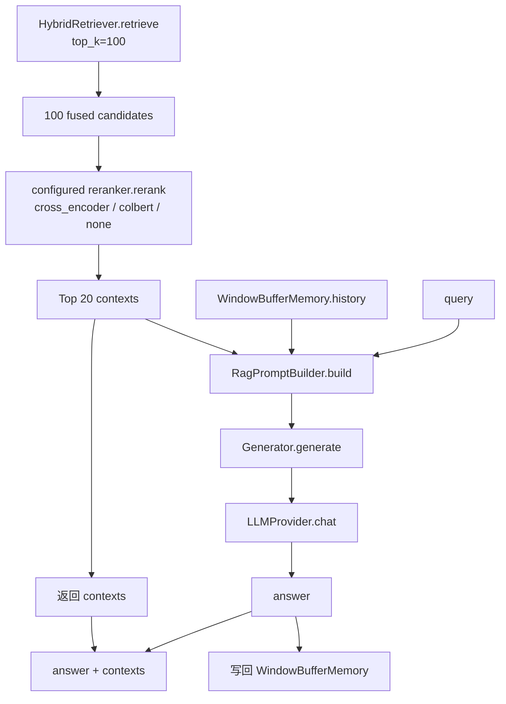

Scale control:

| Stage | Count | Purpose |
| --- | --- | --- |
| Hybrid candidate pool | 100 | Gives the reranker enough candidates, avoiding early misses from a small Top-K. |
| Reranked contexts | 20 | Controls the amount of evidence entering the prompt and generation cost. |

`RagPromptBuilder` formats contexts into fragments containing source, score, and content, and adds a system constraint: answer only based on the context; when the context is insufficient, state that the answer cannot be found in the materials.

Return structure:

```python
{
    "answer": "模型回答",
    "contexts": [
        {
            "source": "rule.md",
            "page": 1,
            "heading_path": "制度 > 报销",
            "version": 2,
            "score": 0.9123,
            "preview": "[制度 > 报销]\\n报销材料需要在 3 天内提交..."
        }
    ]
}
```

## 7. Index Building and Verification Entry Points

Production index-building script:

```bash
cd agent-library/ragx
python3 scripts/build_knowledge_base.py \
  --source data/resources \
  --export-chunks /tmp/ragx-chunks.json
```

Common verification:

```bash
# 静态检查
python3 -m ruff check .

# 全量测试
python3 -m pytest -q

# 只验证版面分析和分块链路
python3 -m pytest tests/test_layout.py -q

# 只验证应用建库、增量同步、检索生成链路
python3 -m pytest tests/test_app_chain.py -q
```

Key audit points for the chunks JSON:

| Check Item | What an Anomaly Means |
| --- | --- |
| `summary.document_count` | Document reading filters or source paths are wrong. |
| `summary.total_chunk_count` | Chunking too fine or too coarse, or text parsing anomalies. |
| `chunks[].metadata.heading_path` | Heading parsing or layout order anomalies. |
| `chunks[].metadata.block_type` | Table, code, or body-text recognition anomalies. |
| `chunks[].metadata.page` / `bbox` | PDF/layout model coordinates not passed through. |
| `chunks[].metadata.layout_confidence` | Low OCR or layout model quality. |
| `chunks[].metadata.content_hash` | Missing fields required by chunk-level reuse or diffing statistics. |

## 8. Common Problem Diagnosis

| Symptom | Check First |
| --- | --- |
| No chunks after index building | Whether sources exist, files are empty, or body text is below `min_chunk`. |
| Old content still recalled after update | Whether the manifest and SQLite use the same path; whether queries carry `is_latest=True`. |
| Table answers lack column names | Whether `_chunk_table` replicates the header; whether exported chunks keep Markdown table headers. |
| PDF two-column content out of order | Check whether it is a scanned file, a table-dense page, or has anomalous bboxes; text-based PDFs should go through `analyze_pdf_text_page`. |
| PDF results cannot jump to a page | Whether the current reading path only goes through Markdown text; the indexing pipeline needs to consume `Block[]` with bboxes directly. |
| Poor exact-term recall | Check `LexicalDocumentStore` tokenization and whether source/heading are written into metadata. |
| Poor paraphrased recall | Check the embedding provider, vector dimension, and whether the vector store was rebuilt. |
| LLM hallucination | Check whether contexts are empty, whether the prompt contains evidence, and whether a relevance threshold fallback is needed. |
| Relevant evidence lost after reranking | Enlarge the candidate pool or replace with a real Cross-Encoder scorer. |

## 9. Extension Points

When integrating stronger layout analysis later, keep downstream interfaces unchanged:

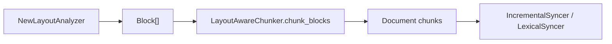

Recommended extension order:

1. Output `Block[]` with a stable reading order from `LayoutAnalyzer.analyze`.
2. Ensure `page`, `bbox`, and `confidence` are written into `Block`.
3. Use the existing `StructureAwareChunker.chunk_blocks` to verify metadata pass-through.
4. Audit chunking results with `--export-chunks`.
5. Then run `evaluate_retrieval` or an annotated-set evaluation of Hit@K, MRR, and source diversity.
