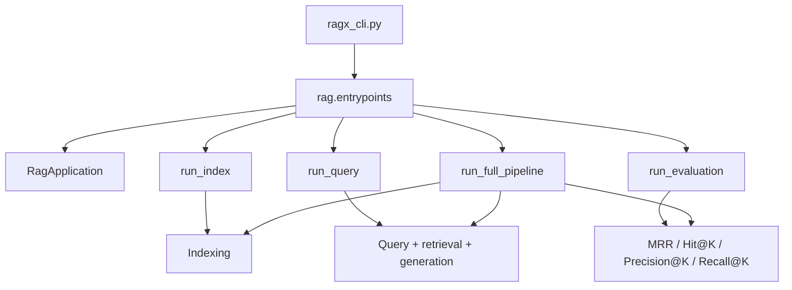

# RAGX Module Entrypoints

This document describes the standalone entrypoints of the three core RAGX modules (index building, Query processing, and retrieval evaluation). Each module can be invoked either through Python Application Programming Interface (API) functions or through a Command-Line Interface (CLI) with subcommands.

## Abbreviations

| Abbreviation | Full Name | Description |
| --- | --- | --- |
| API | Application Programming Interface | Python-callable entrypoint contract. |
| CLI | Command-Line Interface | Shell command wrappers for standalone module verification. |
| JSON | JavaScript Object Notation | Machine-readable output format. |
| JSONL | JSON Lines | Evaluation dataset format with one JSON object per line. |
| MRR | Mean Reciprocal Rank | Retrieval ranking metric. |
| RAG | Retrieval-Augmented Generation | Workflow that generates answers based on retrieved evidence. |

See [RAGX Abbreviations](abbreviations.md) for the full abbreviation table.

## Architecture



The entrypoint layer is only responsible for configuration overrides, argument validation, report formatting, and resource cleanup. The core Retrieval-Augmented Generation (RAG) behavior remains in `RagApplication`.

## CLI Usage

Run in the `agent-library/ragx` directory:

```bash
python ragx_cli.py index --source data/resources --reset
python ragx_cli.py query "RAGX 如何构建索引？" --top-k 3 --reranker-backend colbert
python ragx_cli.py evaluate --query "RAGX 如何构建索引？" --relevant-source rag-sample.md
python ragx_cli.py run "RAGX 如何构建索引？" --source data/resources --evaluate
```

Run in the `agent-library` directory:

```bash
python ragx/ragx_cli.py index --source ragx/data/resources --reset
python ragx/ragx_cli.py query "RAGX 如何构建索引？" --top-k 3
python ragx/ragx_cli.py evaluate --query "RAGX 如何构建索引？" --relevant-source rag-sample.md
python ragx/ragx_cli.py run "RAGX 如何构建索引？" --source ragx/data/resources --evaluate
```

All subcommands support the `--json` flag for machine-readable output.

## Index Module

Purpose: build the SQLite vector store and manifest independently.

CLI:

```bash
python ragx_cli.py index \
  --source data/resources \
  --sqlite-path data/stores/ragx-store.sqlite \
  --manifest-path data/stores/ragx-manifest.json \
  --reset \
  --json
```

API:

```python
from rag.entrypoints import run_index

result = run_index(
    "data/resources",
    sqlite_path="data/stores/ragx-store.sqlite",
    manifest_path="data/stores/ragx-manifest.json",
    reset=True,
)
```

Verification signals:

- `report.added`, `report.updated`, and `report.skipped` confirm synchronization behavior.
- `chunk_count > 0` confirms chunks were persisted.
- `storage.store_exists` and `storage.manifest_exists` confirm storage was created.
- `count_sqlite_chunks(sqlite_path)` independently verifies the number of loadable rows.

## Query Module

Purpose: load an existing index, retrieve evidence, and generate an answer.

CLI:

```bash
python ragx_cli.py query "RAGX 如何构建索引？" \
  --sqlite-path data/stores/ragx-store.sqlite \
  --manifest-path data/stores/ragx-manifest.json \
  --metadata-filter '{"is_latest": true}' \
  --top-k 3 \
  --json
```

API:

```python
from rag.entrypoints import run_query

result = run_query(
    "RAGX 如何构建索引？",
    sqlite_path="data/stores/ragx-store.sqlite",
    manifest_path="data/stores/ragx-manifest.json",
    reranker_backend="cross_encoder",
    metadata_filter={"is_latest": True},
    top_k=3,
)
```

Verification signals:

- `answer` confirms generation ran.
- `contexts` confirms retrieval evidence was returned.
- `context_count <= top_k` confirms the query entrypoint controls the evidence count.
- `reranker_backend` confirms whether Cross-Encoder, ColBERT, or no reranking was used.

## Evaluation Module

Purpose: evaluate retrieval quality only, without triggering answer generation.

CLI for a single query:

```bash
python ragx_cli.py evaluate \
  --query "RAGX 如何构建索引？" \
  --relevant-source rag-sample.md \
  --top-k-values 1,3,5 \
  --json
```

JSONL dataset format:

```json
{"query": "RAGX 如何构建索引？", "relevant_sources": ["rag-sample.md"]}
{"query": "混合检索如何融合结果？", "relevant_doc_ids": ["hybird-search.md"]}
```

Dataset CLI:

```bash
python ragx_cli.py evaluate --dataset eval.jsonl --top-k-values 1,3,5 --json
```

API:

```python
from rag.entrypoints import run_evaluation

result = run_evaluation(
    query="RAGX 如何构建索引？",
    relevant_sources=["rag-sample.md"],
    top_k_values=(1, 3, 5),
)
```

Verification signals:

- `reports[].mrr` confirms MRR computation.
- `reports[].hit_at_k`, `precision_at_k`, and `recall_at_k` confirm K-based metrics.
- `summary.average_mrr` and `summary.hit_rate_at_k` confirm batch aggregation.

## Full Pipeline

Purpose: combine the three modules while keeping the standalone entrypoints.

CLI:

```bash
python ragx_cli.py run "RAGX 如何构建索引？" \
  --source data/resources \
  --reset \
  --evaluate \
  --relevant-source rag-sample.md \
  --json
```

API:

```python
from rag.entrypoints import run_full_pipeline

result = run_full_pipeline(
    "data/resources",
    "RAGX 如何构建索引？",
    reset=True,
    evaluate=True,
    relevant_sources=["rag-sample.md"],
)
```

The returned payload contains independent `index`, `query`, and optional `evaluation` sections, so tests can assert each stage separately.

## Verification Commands

```bash
python -m ruff check rag/entrypoints.py ragx_cli.py tests/test_module_entrypoints.py
python -m pytest tests/test_module_entrypoints.py -q
python -m pytest -q --cov=. --cov-report=term-missing
```
