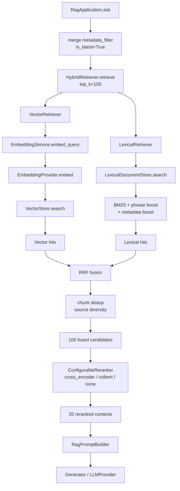
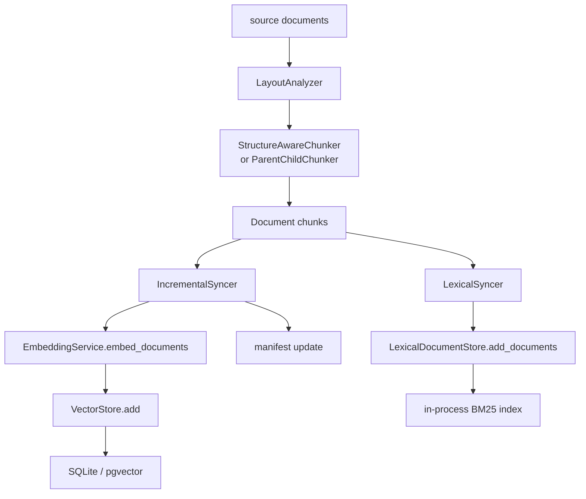
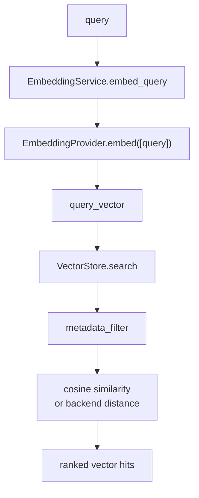
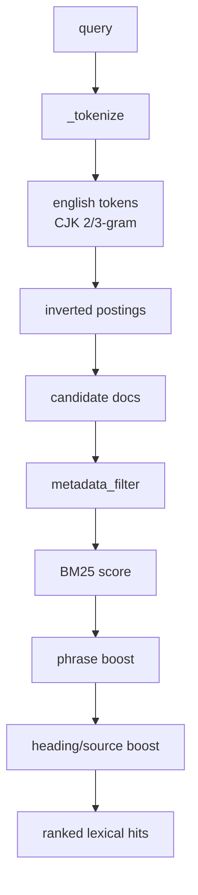
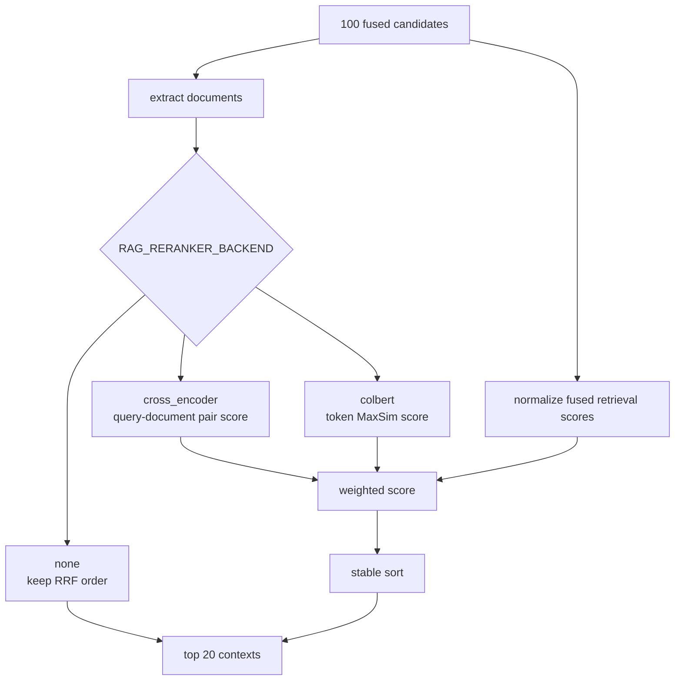

# RAGX Multi-Recall Retrieval Design

This document describes the production rules, module boundaries, data flow, fusion strategies, reranking strategies, extension methods, and troubleshooting for RAGX multi-recall. The current recall channels are vector recall and Best Matching 25 (BM25) lexical recall, organized at the framework layer under a unified `Retriever` contract. Additional retrieval channels such as metadata/rule-based, query rewrite, parent-child, or others can be added later under the same rules.

## Abbreviations

| Abbreviation | Full Name | Description |
| --- | --- | --- |
| ACL | Access Control List | Access control list, used for permission filtering. |
| BM25 | Best Matching 25 | Lexical relevance ranking function. |
| CJK | Chinese, Japanese, and Korean | The set of Chinese, Japanese, and Korean characters. |
| ColBERT | Contextualized Late Interaction over BERT | A late-interaction retrieval/reranking method based on token-level MaxSim. |
| ID | Identifier | Stable identifier. |
| LLM | Large Language Model | Large language model. |
| MRR | Mean Reciprocal Rank | Mean reciprocal rank. |
| NDCG | Normalized Discounted Cumulative Gain | Normalized discounted cumulative gain. |
| RAG | Retrieval-Augmented Generation | Retrieval-augmented generation. |
| RRF | Reciprocal Rank Fusion | Reciprocal rank fusion. |

See [RAGX Abbreviations](abbreviations.md) for the full abbreviation table.

## Design Goals

Multi-recall is not about simply concatenating multiple search results; it merges the strengths of different retrieval channels into a single candidate pool:

| Goal | Description |
| --- | --- |
| Improve Recall | Vector recall covers semantic paraphrases, colloquial expressions, cross-language or synonymous questions; Best Matching 25 (BM25) lexical recall covers proper nouns, identifiers, titles, code identifiers, and exact phrases. |
| Reduce single-channel bias | Do not assume any one channel is always reliable; each channel only provides candidates within its own ranking space. |
| Keep permissions and versions consistent | All channels must use the same `metadata_filter` to avoid the vector side and lexical side seeing different versions or unauthorized content. |
| Support stable extension | A new channel enters the fusion layer as long as it implements `Retriever.retrieve(query, top_k, metadata_filter)`. |
| Keep the generation chain simple | Recall, fusion, and reranking only output `ScoredDocument`; the prompt builder and Large Language Model (LLM) provider do not need to know how many recall channels exist. |

## Core Contract

Multi-recall depends on a single unified interface:

```python
class Retriever(ABC):
    def retrieve(
        self,
        query: str,
        top_k: int = 4,
        metadata_filter: dict | None = None,
    ) -> list[ScoredDocument]:
        ...
```

All recall channels must follow these rules:

| Rule | Requirement | Reason |
| --- | --- | --- |
| Consistent input | `query`, `top_k`, and `metadata_filter` must be passed to every channel as-is. | Ensures all channels face the same question and the same permission/version scope. |
| Consistent output | Return `ScoredDocument(document, score)`, sorted descending by the channel's internal relevance. | The fusion layer only reads ranking positions and a light raw-score compensation. |
| Stable IDs | `Document.id` should be stable; when missing, it must be derivable from `metadata.doc_id/source + chunk_index`. | After RRF, chunks need to be deduplicated to prevent the same evidence from entering the prompt repeatedly. |
| Scores are not comparable across channels | Each channel's `score` is only meaningful within that channel and must not be summed across channels directly. | BM25, cosine, and rule scores have different scales; summing them directly lets one channel dominate. |
| Consistent filter semantics | Filters such as `is_latest`, ACL, source, and block_type must take effect in every channel. | Prevents outdated, unauthorized, or wrong-category chunks from entering the candidate pool. |
| Channels may fail but must not silently fabricate | Provider, index, or storage errors should surface directly; do not generate mock candidates. | Production issues need to surface early so erroneous results are not treated as real recalls. |

## Current Module Diagram



Key code locations:

| Module | Responsibility |
| --- | --- |
| `rag/retrieval/hybrid.py` | Orchestrates multi-recall and hands each channel's results to the fusion function. |
| `rag/retrieval/fusion.py` | RRF fusion, chunk deduplication, and source diversity control. |
| `rag/retrieval/retriever.py` | Vector retrieval channel. |
| `rag/retrieval/lexical.py` | BM25 lexical retrieval channel. |
| `rag/retrieval/cross_encoder.py` | Reranks fused candidates as query-document pairs. |
| `rag/retrieval/colbert.py` | Reranks fused candidates via ColBERT token-level MaxSim interaction. |
| `rag/retrieval/reranker.py` | Keeps the cross-encoder compatibility export and selects the reranker backend by configuration. |
| `rag/retrieval/evaluation.py` | Evaluates reranked results without participating in ranking; see [`docs/retrieval-evaluation.md`](retrieval-evaluation.md) for details. |
| `rag/providers/factory.py` | Unified provider injection, registration, and default construction rules. |

## Indexing Phase: Multi-Index Synchronization

RAGX builds both the vector index and the lexical index during indexing. Both indexes come from the same batch of chunks, with consistent metadata and version fields.



Constraints during the indexing phase:

| Item | Constraint |
| --- | --- |
| Chunk source | The vector index and the lexical index must be produced by the same chunker; they must not be chunked separately. |
| Manifest | Records incremental state as `doc_id -> source_hash/version/updated_at`. |
| Version fields | New-version chunks are written with `metadata.version` and `metadata.is_latest=True`; old versions are deleted on update or excluded via filters. |
| ACL fields | `index(source, acl=[...])` writes the ACL into chunk metadata, filtered at query time via `metadata_filter`. |
| Lexical index | Currently an in-process index, rebuilt with each `index()` call; the vector store and manifest are the source of truth for persistence. |

## Query Phase: Multi-Recall Steps

### 1. Filter Normalization

`RagApplication.ask(query, metadata_filter=None)` applies a default overlay:

```python
flt = {"is_latest": True}
if metadata_filter:
    flt.update(metadata_filter)
```

Callers may append:

| Filter | Purpose |
| --- | --- |
| `acl` | Permission control; only recalls content visible to the current user. |
| `source` | Restrict to a specific file or resource origin. |
| `doc_id` | Restrict to a specific logical document. |
| `block_type` | Restrict to structural types such as body text, tables, or code. |
| `heading_path` | Restrict to a section range, useful for targeted Q&A or debugging. |

All channels must use the same `flt`. If a channel does not support a filter, support must be added explicitly or surfaced in tests rather than silently ignored.

### 2. Candidate Pool Expansion

The application layer uses a fixed two-stage size control:

| Stage | Default Count | Description |
| --- | --- | --- |
| hybrid candidate pool | 100 | Recall expands the candidate pool to avoid relevant evidence being lost early within a small Top-K. |
| reranked contexts | 20 | After cross-encoder or ColBERT reranking, only a small amount of context is passed to the prompt to control noise and cost. |

`HybridRetriever` also applies internally:

```python
candidate_k = max(FusionConfig.candidate_k, top_k)
```

Therefore, even if the caller requests `top_k=4`, each channel first recalls the default 100 candidates, which are then narrowed by RRF and the reranker.

### 3. Vector Recall

The vector channel solves "different phrasing but semantically related" problems:



Key rules:

| Item | Description |
| --- | --- |
| Provider | Resolved uniformly by `rag.providers`. Can be injected directly or registered as a builder; defaults to `agent_provider`. |
| Vector dimension | SQLite has no strict schema; pgvector depends on a fixed dimension, so the store must be rebuilt after the model or `RAG_EMBEDDING_DIM` changes. |
| Query/document symmetry | Currently the same embedding provider encodes both query and chunk; if an asymmetric model is adopted, the difference should be encapsulated in the provider. |
| Score semantics | SQLite currently uses Python-side cosine similarity; other backends may return their own similarity, but must not be assumed comparable to BM25. |

Common failures:

| Symptom | Possible Cause | Troubleshooting |
| --- | --- | --- |
| Semantically similar questions are not recalled | Misconfigured embedding provider, dimension mismatch, or index not rebuilt. | Check provider healthcheck, store row count, vector dimension, and whether the query vector is non-empty. |
| Exact identifiers do not rank highly | Vector models are weaker at literal matching. | Rely on the lexical channel and RRF; raise `lexical_weight` if needed. |
| Old content is recalled after updates | Manifest/store path mismatch, or the query lacks `is_latest=True`. | Check `RAG_SQLITE_PATH`, `RAG_MANIFEST_PATH`, and the default filter. |

### 4. Lexical Recall

The lexical channel solves "must hit literally" problems. `LexicalDocumentStore` uses BM25, phrase boosting, and metadata boosting. For Chinese, it does not rely on an external tokenizer but combines English word tokenization with Chinese 2/3-grams.



Base BM25 term:

```text
score(q, d) = Σ IDF(t) * (tf(t,d) * (k1 + 1)) /
              (tf(t,d) + k1 * (1 - b + b * len(d) / avg_len))
```

Current default parameters:

| Parameter | Value | Purpose |
| --- | --- | --- |
| `BM25_K1` | 1.5 | Controls the speed of term frequency saturation. |
| `BM25_B` | 0.75 | Controls the strength of document length normalization. |
| phrase boost | Constant in code | Weights consecutive phrase hits in the query. |
| metadata boost | Constant in code | Weights metadata hits such as heading path, source, and doc_id. |

The lexical channel is especially suited to:

| Query Type | Example |
| --- | --- |
| Exact identifier | "What are the acceptance criteria for PRD-1024?" |
| File name or source | "The CUI flow in merchant-assistant" |
| Heading phrase | "Deadline for submitting expense materials" |
| Code identifier | "The top_k rule of `HybridRetriever.retrieve`" |

### 5. RRF Fusion

The key principle of RRF is "fuse by each channel's internal ranking, not by directly comparing raw scores."

```text
fused_score(doc) =
    Σ channel_weight / (rrf_k + rank_in_channel)
    + raw_score_bonus
```

Parameters live in `FusionConfig`:

| Parameter | Default | Description |
| --- | --- | --- |
| `candidate_k` | 100 | Lower bound on the number of candidates recalled per channel. |
| `rrf_k` | 60 | Ranking smoothing constant; larger is smoother, smaller emphasizes top ranks. |
| `vector_weight` | 1.0 | Weight of the vector recall channel. |
| `lexical_weight` | 1.5 | Weight of the lexical recall channel; currently slightly higher to protect proper nouns and exact phrases. |
| `raw_score_weight` | 0.05 | Light compensation from each channel's internal raw score, normalized by the channel's max absolute score first. |
| `source_diversity_penalty` | 0.01 | Slight penalty when the same source occupies consecutive positions, improving context diversity. |

The fusion stage also performs:

| Operation | Rule |
| --- | --- |
| Chunk deduplication | Prefers `Document.id`; falls back to `doc_id/source + chunk_index` when missing. |
| Best raw score record | Used for diagnostics only, not as a cross-channel primary ranking signal. |
| Source diversity | Selects one at a time from the fused candidates; repeated sources receive a slight penalty. |

### 6. Configurable Reranking: Cross-Encoder or ColBERT

The output of RRF is a set of fused recall candidates, not the final contexts. The application layer continues with reranking:



The default `HeuristicCrossEncoderScorer` is a deterministic local implementation for environments without external models and for unit tests. To connect a real Cross-Encoder in production, only this needs to be implemented:

```python
class MyScorer:
    def score(self, query: str, documents: Sequence[Document]) -> list[float]:
        return model_scores
```

The reranker does not need to understand the multi-recall origins. It only receives the already-fused candidate list and returns the final contexts.

The ColBERT reranking entry point is `rag.retrieval.colbert.ColBERTReranker`. It first encodes the query and candidate documents into token-level vectors, then computes interaction scores via MaxSim:

```text
score(q, d) = mean_i max_j cosine(q_i, d_j)
```

ColBERT supports two encoders:

| Encoder | Purpose |
| --- | --- |
| `TransformersColBERTEncoder` | Loads a HuggingFace model after configuring `RAG_COLBERT_MODEL`; requires `torch` and `transformers`. |
| `HashingColBERTEncoder` | Deterministic local encoder used when no model is configured, for unit tests, functional tests, and model-free environments. |

See [`docs/reranking-strategies.md`](reranking-strategies.md) for related configuration and performance comparisons.

## Provider Injection and Its Relationship to Multi-Recall

Providers are responsible only for model capabilities, not retrieval strategy:

| Provider | Used In | Rule |
| --- | --- | --- |
| Embedding provider | Vector recall indexing and query phases. | Must expose `embed(texts)`. |
| LLM provider | Final generation phase. | Must expose `chat(messages, **kwargs)`. |
| Cross-Encoder scorer | Reranking phase. | Must expose `score(query, documents)`; it is not an LLM provider. |
| ColBERT encoder | Reranking phase. | Must expose `encode_queries` and `encode_documents`; it is not an embedding provider. |

RAGX supports two kinds of external provider integration:

```python
from rag.app import RagApplication
from rag.providers import ProviderBundle, register_provider

# 方式一：直接注入已经初始化好的实例
app = RagApplication(
    cfg,
    providers=ProviderBundle(embedding=my_embedding, llm=my_llm),
)

# 方式二：注册 builder，之后由 cfg.provider 或显式 name 选择
register_provider(
    "my-provider",
    embedding_builder=lambda cfg: my_embedding_builder(cfg),
    llm_builder=lambda cfg: my_llm_builder(cfg),
    overwrite=True,
)
app = RagApplication(cfg_with_provider_name)
```

Both approaches follow the same rule: RAGX only checks whether an object has `embed` and `chat` capabilities; it does not embed vendor or platform checks into the retrieval chain.

## Extending with New Recall Channels

When adding a new recall channel, follow these steps:

1. Implement `Retriever.retrieve(query, top_k, metadata_filter)`.
2. Return stable `Document.id` values with complete metadata.
3. Ensure internal results are sorted descending by the channel's relevance.
4. Add the channel to the channel list in `HybridRetriever` or a new orchestrator.
5. Add the corresponding weight in `FusionConfig`, or change weights to a channel-name mapping.
6. Add unit tests: filter forwarding, candidate_k expansion, RRF ranking, deduplication, and degradation behavior.
7. Evaluate Hit@K, Precision@K, Recall@K, and MRR on a labelled set; see [`docs/retrieval-evaluation.md`](retrieval-evaluation.md) for evaluation details. If graded relevance is available, also add NDCG@K.

Example candidate channels:

| Channel | Applicable Scenario | Notes |
| --- | --- | --- |
| metadata/rule recall | Filtering on explicit source, doc_id, heading path, or time range. | Must not bypass ACL; rule hit scores rank only within this channel. |
| query rewrite recall | Generating multiple rewrites for colloquial, abbreviated, or misspelled queries. | Rewritten candidates still go through the same RRF fusion and must not directly replace the original query. |
| parent-child recall | Expanding a child chunk hit to the parent chunk context. | Parent chunks must not break the original chunk's permission and version metadata. |
| graph/entity recall | Expanding related documents based on entity relations. | Expansion radius must be limited to prevent candidate pool noise from growing. |

## Tuning Order

Tune in the following order before changing models or enlarging the prompt:

| Order | Item | Basis for Judgment |
| --- | --- | --- |
| 1 | Chunk structure and metadata | If the correct evidence is not in any channel's candidates at all, look at chunking and metadata first. |
| 2 | `candidate_k` | If the correct evidence falls outside the Top 100, expand recall candidates or optimize the index. |
| 3 | `lexical_weight/vector_weight` | If the correct evidence is recalled but ranks low after fusion, tune the weights. |
| 4 | `rrf_k` | Increase if top candidates fluctuate; decrease if strong top hits are not prominent enough. |
| 5 | Reranker backend | If fused candidates contain the correct evidence but the final context order is wrong, compare cross-encoder and ColBERT first. |
| 6 | Prompt top_k | Only adjust the number of contexts entering the prompt when the reranked Top 20 is already accurate but the answer lacks context. |

## Troubleshooting Matrix

| Symptom | Layer to Inspect | Resolution |
| --- | --- | --- |
| Neither channel has the correct evidence | Chunking, indexing, metadata_filter | Check chunk JSON, store row count, manifest, and whether filters are too strict. |
| Vector has evidence, lexical does not | Tokenization or document wording | Check Chinese n-grams and whether headings/source are in metadata; add aliases or phrase boosts if needed. |
| Lexical has evidence, vector does not | Embedding provider or semantic model | Check provider configuration, embedding dimension, and whether the vector store was rebuilt. |
| Correct evidence ranks low after fusion | RRF parameters | Tune `lexical_weight`, `vector_weight`, `rrf_k`, and validate with a labelled set. |
| Correct evidence is demoted after reranking | Reranker backend | Check `RAG_RERANKER_BACKEND`, query normalization, real model outputs, and weight configuration. |
| The same file repeats too much in contexts | Diversity control | Tune `source_diversity_penalty` or reduce duplication at the chunker layer. |
| Old versions are returned | Version filtering | Confirm the default `is_latest=True` filter is in effect and old chunks are cleaned up on update. |
| Results leak unauthorized content | ACL filtering | Confirm every retriever applies the same `metadata_filter`. |

## Acceptance Checklist

After any multi-recall change, verify at minimum:

| Check Item | Expectation |
| --- | --- |
| Filter forwarding | Both vector and lexical receive the same `metadata_filter`. |
| candidate_k expansion | Even with a small requested Top-K, each channel still expands candidates to `candidate_k`. |
| Deduplication | The same `Document.id` never enters the fused result twice. |
| Weight effect | Adjusting `lexical_weight/vector_weight` affects ranking as expected. |
| Source diversity | Consecutive positions held by the same source receive a slight penalty. |
| Rerank truncation | By default, 20 contexts are selected from 100 fused candidates; the backend is cross-encoder or ColBERT. |
| Provider injection | Both directly injected providers and registry providers are usable by the application layer. |
| Evaluation metrics | With labels, outputs Hit@K, Precision@K, Recall@K, and MRR; without labels, outputs health diagnostics. |
