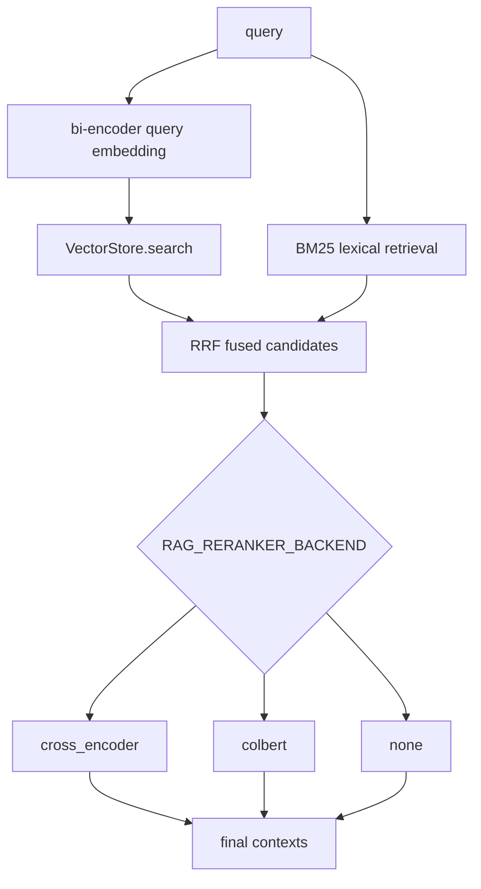
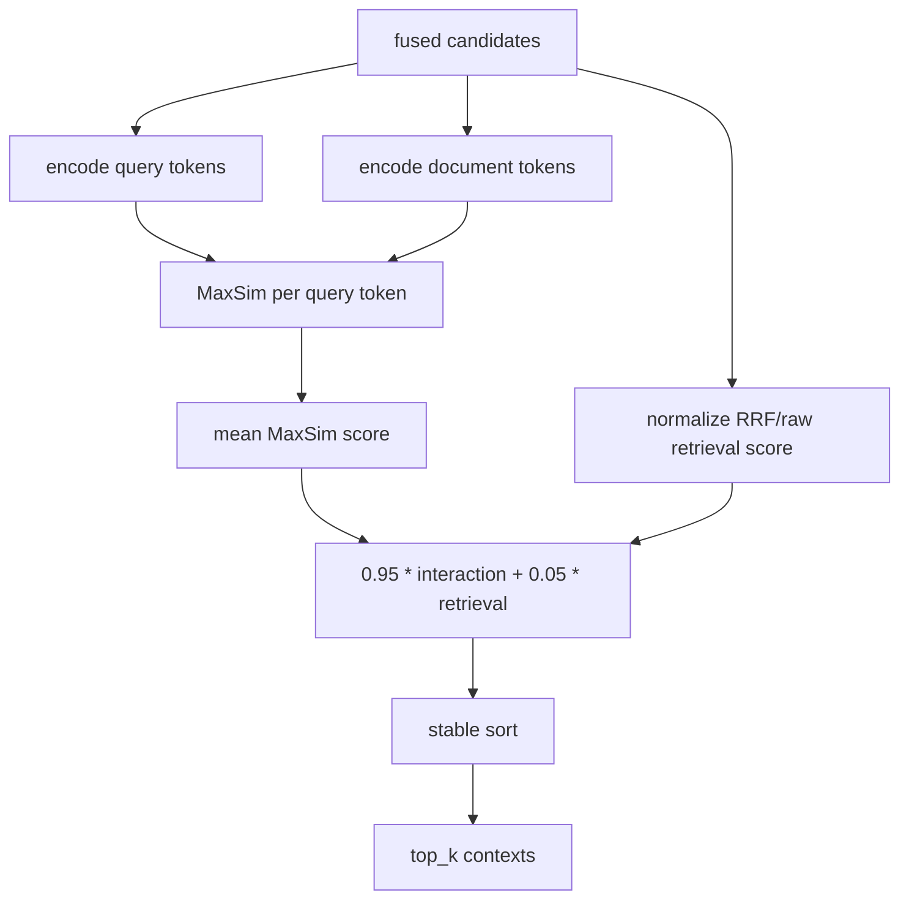

# RAGX Reranking Strategies

This document describes the responsibility boundaries, configuration options, usage, and performance trade-offs of RAGX's default bi-encoder search, Cross-Encoder reranking, and ColBERT late-interaction reranking.

## Abbreviations

| Abbreviation | Full Name | Description |
| --- | --- | --- |
| BM25 | Best Matching 25 | Lexical relevance ranking function. |
| ColBERT | Contextualized Late Interaction over BERT | A late-interaction retrieval/reranking method based on token-level MaxSim. |
| LLM | Large Language Model | Large language model. |
| RAG | Retrieval-Augmented Generation | Retrieval-augmented generation. |
| RRF | Reciprocal Rank Fusion | Reciprocal rank fusion. |

See [RAGX Abbreviations](abbreviations.md) for the full abbreviation table.

## Default Search Configuration

RAGX's default search configuration is `bi_encoder` candidate search:

1. During indexing, an embedding provider independently encodes document chunks, which are written to SQLite or pgvector.
2. At query time, the same embedding provider independently encodes the query and performs vector recall.
3. Best Matching 25 (BM25) lexical recall runs in parallel.
4. Reciprocal Rank Fusion (RRF) fuses vector and lexical candidates.
5. `RAG_RERANKER_BACKEND` selects whether a second-stage reranking is executed.



`RAG_SEARCH_BACKEND` currently defaults to and only supports `bi_encoder`, used to explicitly mark the candidate search form. `RAG_RERANKER_BACKEND` decides the ranking strategy applied to fused candidates.

## Cross-Encoder Analysis

The Cross-Encoder jointly encodes and scores each `(query, document)` pair. RAGX keeps the original entry point `rag.retrieval.cross_encoder.CrossEncoderReranker` and the compatibility function `rank_by_relevance`; the default configuration still uses cross-encoder reranking so existing callers remain unchanged.

Advantages:

| Advantage | Description |
| --- | --- |
| High fine-ranking quality | Query and document interact within the same model forward pass, capturing word order, negation, contextual references, and fine-grained semantics. |
| Clean integration boundary | Only scores fused candidates; it does not change vector store schema, chunk metadata, or RRF fusion logic. |
| Robust to the candidate pool | The current implementation blends Cross-Encoder scores with a small amount of raw recall scores, reducing jitter among tied or low-confidence candidates. |
| Suited to Top-N fine ranking | When the candidate count is controlled, fine-ranking gains usually exceed simply enlarging the prompt Top-K. |

Disadvantages:

| Disadvantage | Impact |
| --- | --- |
| Latency grows linearly with candidate count | 100 candidates means 100 query-document pair forward passes, which is costly under high online concurrency. |
| Document-side representations are hard to precompute | Query and document are encoded jointly, so document vectors cannot be reused ahead of time like bi-encoder ones. |
| Sensitive to long-document truncation | Overlong chunks get truncated by the model, and key evidence may fall outside the input window. |
| Strong training/model dependency | A real production scorer requires a domain-adapted model; the current local heuristic scorer is only for model-free testing and offline validation. |

Applicable scenarios:

| Scenario | Recommendation |
| --- | --- |
| The candidate pool is already small and final Top-K precision matters | Use `cross_encoder`. |
| Queries are complex with negations or many conditions | Use a real Cross-Encoder scorer. |
| High concurrency, low latency, large candidate pool | Use with caution; shrink the candidate pool first or switch to ColBERT/distilled models. |

## ColBERT Approach

ColBERT performs late interaction using token-level vectors. The RAGX implementation lives in `rag/retrieval/colbert.py` and includes:

| Component | Responsibility |
| --- | --- |
| `ColBERTEncoder` | Token-level encoding protocol defining `encode_queries` and `encode_documents`. |
| `TransformersColBERTEncoder` | Optional HuggingFace model loader depending on `torch` and `transformers`. |
| `HashingColBERTEncoder` | Dependency-free deterministic token encoder for local testing and offline validation. |
| `ColBERTReranker` | Runs MaxSim interaction scoring over RRF-fused candidates and outputs ranked `ScoredDocument` objects. |
| `rank_by_colbert` | ColBERT compatibility entry point, independent of the original Cross-Encoder entry point. |

ColBERT ranking flow:



MaxSim formula:

```text
score(q, d) = mean_i max_j cosine(q_i, d_j)
```

RAGX maps MaxSim to `0..1` and then lightly fuses it with normalized retrieval scores to avoid unstable ranking when multiple candidates have nearly identical interaction scores.

## Configuration Options

| Configuration | Default | Description |
| --- | --- | --- |
| `RAG_SEARCH_BACKEND` | `bi_encoder` | Candidate search configuration; only the default bi-encoder search is supported. |
| `RAG_RERANKER_BACKEND` | `cross_encoder` | Second-stage reranking strategy: `cross_encoder`, `colbert`, or `none`. |
| `RAG_CROSS_ENCODER_WEIGHT` | `0.95` | Cross-Encoder score weight. |
| `RAG_CROSS_ENCODER_RETRIEVAL_SCORE_WEIGHT` | `0.05` | Stabilizing weight of the original retrieval score in the Cross-Encoder stage. |
| `RAG_COLBERT_MODEL` | empty | HuggingFace model name; when empty, the local deterministic encoder is used. |
| `RAG_COLBERT_QUERY_MAX_TOKENS` | `32` | ColBERT query token limit. |
| `RAG_COLBERT_DOCUMENT_MAX_TOKENS` | `180` | ColBERT document token limit. |
| `RAG_COLBERT_BATCH_SIZE` | `8` | Batch size for Transformers model encoding. |
| `RAG_COLBERT_INTERACTION_WEIGHT` | `0.95` | Weight of the ColBERT MaxSim interaction score. |
| `RAG_COLBERT_RETRIEVAL_SCORE_WEIGHT` | `0.05` | Stabilizing weight of the original retrieval score in the ColBERT stage. |
| `RAG_COLBERT_HASHING_DIM` | `64` | Token vector dimension of the local deterministic encoder. |

## Usage Examples

Default Cross-Encoder:

```bash
cd agent-library/ragx
RAG_RERANKER_BACKEND=cross_encoder \
python3 ragx_cli.py query "报销材料几天内提交？" --top-k 3
```

Local ColBERT validation:

```bash
cd agent-library/ragx
RAG_RERANKER_BACKEND=colbert \
python3 ragx_cli.py query "报销材料几天内提交？" --top-k 3
```

ColBERT with a HuggingFace model:

```bash
cd agent-library/ragx
python3 -m pip install torch transformers
RAG_RERANKER_BACKEND=colbert \
RAG_COLBERT_MODEL=colbert-ir/colbertv2.0 \
python3 ragx_cli.py query "报销材料几天内提交？" --top-k 3
```

Overriding the reranker directly via the CLI:

```bash
cd agent-library/ragx
python3 ragx_cli.py query "RAGX 如何检索？" \
  --reranker-backend colbert \
  --top-k 3
```

Python API:

```python
from config.settings import Settings
from rag.app import RagApplication

cfg = Settings(provider="openai", reranker_backend="colbert")
app = RagApplication(cfg)
result = app.ask("报销材料几天内提交？", top_k=3)
```

Disabling second-stage reranking, using only bi-encoder + BM25 + RRF:

```bash
cd agent-library/ragx
RAG_RERANKER_BACKEND=none \
python3 ragx_cli.py query "报销材料几天内提交？"
```

## Performance and Effectiveness Comparison

| Approach | Document-Side Precomputation | Query Latency | Memory/Storage | Ranking Quality | Applicable Scenario |
| --- | --- | --- | --- | --- | --- |
| bi-encoder + BM25 + RRF | Yes | Low | Low | Medium; relies on embedding and lexical complementarity | Default search, recall expansion, low-latency scenarios. |
| Cross-Encoder reranking | No | High; approximately O(candidate_count) model forward passes | Low | High; pair-level interaction is the most thorough | Small candidate pools, high-precision fine ranking. |
| ColBERT reranking | Document token vectors can be precomputed; current RAGX encodes candidates on the fly | Medium to high; MaxSim can be batched | Medium-high; token-level vectors are larger | Above plain bi-encoder, usually below a strong Cross-Encoder | Needs more interaction capability while preserving room for document-side representation reuse. |

To stay compatible with the existing SQLite/pgvector schema, RAGX's current ColBERT implementation is integrated as a late-interaction reranker over fused candidates. Making ColBERT a first-stage recall channel later would require a token-level multi-vector index, a persistence schema, and approximate MaxSim retrieval, which would change the current vector store interface.

## Verification Commands

```bash
cd agent-library/ragx
python3 -m ruff check rag/retrieval/colbert.py rag/retrieval/reranker.py
python3 -m pytest tests/test_colbert_retrieval.py -q
python3 -m pytest tests/test_hybrid_retrieval.py -q
```

Functional acceptance focus:

| Check Item | Expectation |
| --- | --- |
| Default search | `search_backend=bi_encoder`. |
| Cross-encoder | With `RAG_RERANKER_BACKEND=cross_encoder`, the original entry point returns contexts normally. |
| ColBERT | With `RAG_RERANKER_BACKEND=colbert`, indexing, querying, and context output all work. |
| Isolation | The two reranker backends only affect the reranking strategy, not indexing, metadata filters, the vector store, or the BM25 index. |
| Optional dependencies | Without `torch/transformers` installed, the local encoder still supports testing; after configuring `RAG_COLBERT_MODEL`, missing dependencies produce clear installation guidance. |
