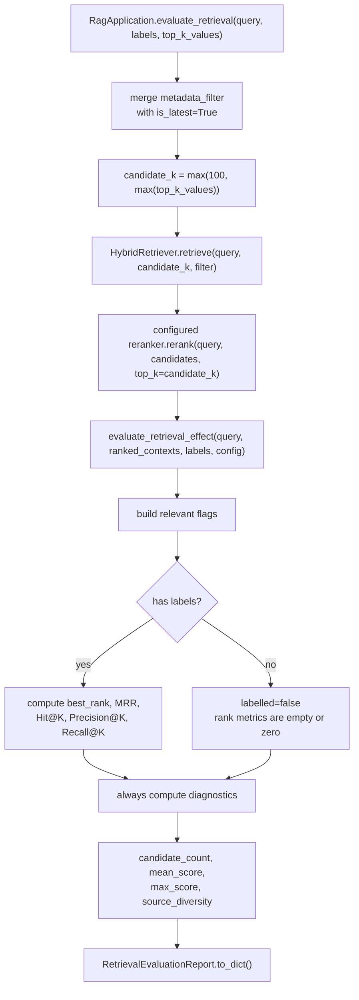
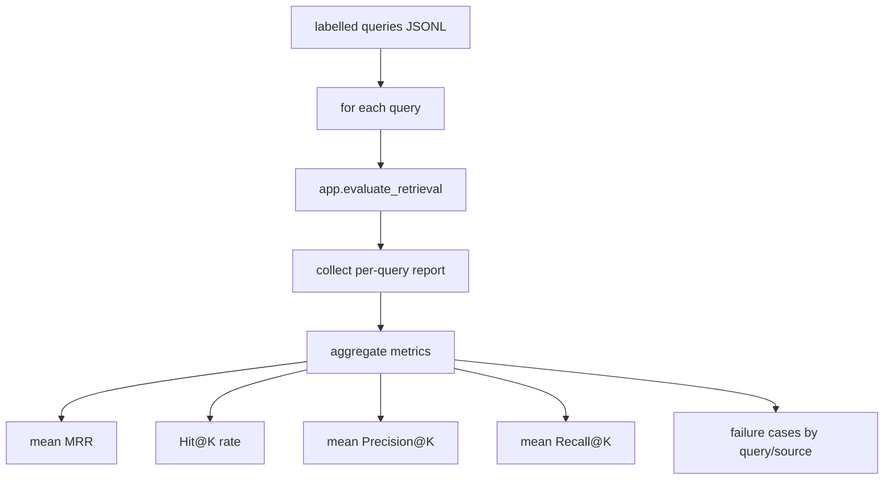

# RAGX Retrieval Evaluation Design

This document describes the responsibility boundaries, call chain, metric definitions, labelling rules, output structure, and troubleshooting of RAGX retrieval evaluation logic. The evaluation module only evaluates ranking results that have already completed recall, fusion, and reranking; it does not participate in recall ranking and does not trigger Large Language Model (LLM) generation.

## Abbreviations

| Abbreviation | Full Name | Description |
| --- | --- | --- |
| BM25 | Best Matching 25 | Lexical relevance ranking function. |
| ColBERT | Contextualized Late Interaction over BERT | A late-interaction retrieval/reranking method based on token-level MaxSim. |
| LLM | Large Language Model | Large language model. |
| MRR | Mean Reciprocal Rank | Mean reciprocal rank. |
| NDCG | Normalized Discounted Cumulative Gain | Normalized discounted cumulative gain. |
| RAG | Retrieval-Augmented Generation | Retrieval-augmented generation. |
| RRF | Reciprocal Rank Fusion | Reciprocal rank fusion. |

See [RAGX Abbreviations](abbreviations.md) for the full abbreviation table.

## Goals and Boundaries

RAGX retrieval evaluation answers three questions:

| Question | Evaluation Target |
| --- | --- |
| Was the correct evidence recalled? | Look at Hit@K, Recall@K, and best_rank. |
| Is the correct evidence ranked high enough? | Look at Mean Reciprocal Rank (MRR), Precision@K, and the density of relevant evidence within the Top-K window. |
| Is retrieval healthy when no labels exist? | Look at candidate_count, mean_score, max_score, and source_diversity. |

Responsibility boundaries:

| Layer | Responsibility | Evaluated? |
| --- | --- | --- |
| `HybridRetriever` | Vector recall + Best Matching 25 (BM25) lexical recall + Reciprocal Rank Fusion (RRF) fusion. | No; only produces candidates. |
| configurable reranker | Applies Cross-Encoder, ColBERT, or no-op reranking to fused candidates according to `RAG_RERANKER_BACKEND`. | No; only produces ranking results. |
| `RagApplication.evaluate_retrieval` | Executes one full retrieval and rerank pass and hands the results to the evaluation function. | Yes; the application-layer entry point. |
| `evaluate_retrieval_effect` | Only evaluates an already-ranked list of `ScoredDocument` objects. | Yes; pure-function evaluation. |
| `Generator / LLMProvider` | Calls a Large Language Model (LLM) to generate answers from contexts. | No; never invoked by the evaluation entry point. |

## Call Chain



Key points:

| Step | Rule |
| --- | --- |
| Filter merging | `is_latest=True` is always enforced by default; a caller-supplied `metadata_filter` is overlaid on top. |
| Candidate pool | During evaluation, `candidate_k=max(DEFAULT_RETRIEVAL_CANDIDATE_K, max(top_k_values))`, at least 100 by default. |
| Reranking | Evaluation uses the configured reranked result, not just the RRF fusion result. |
| No generation triggered | Evaluation does not call the prompt builder, generator, or LLM provider. |
| Output format | `RetrievalEvaluationReport.to_dict()` returns a JSON-friendly dictionary. |

## API Entry Points

### Application-Layer Entry Point

```python
report = app.evaluate_retrieval(
    "报销材料几天内提交？",
    relevant_sources=["rule.md"],
    top_k_values=(1, 3, 5),
)
```

Parameter semantics:

| Parameter | Type | Description |
| --- | --- | --- |
| `query` | `str` | User query text. |
| `metadata_filter` | `dict | None` | Optional filters; the application layer automatically overlays `is_latest=True`. |
| `relevant_sources` | `list[str] | None` | Labelled relevant source file names. |
| `relevant_doc_ids` | `list[str] | None` | Labelled relevant logical document IDs. |
| `relevant_chunk_ids` | `list[str] | None` | Labelled relevant chunk IDs. |
| `top_k_values` | `tuple[int, ...]` | Metric windows, default `(1, 3, 5)`; invalid K values are filtered at the lower layer. |

### Pure-Function Entry Point

```python
report = evaluate_retrieval_effect(
    query="报销材料",
    ranked_contexts=contexts,
    relevant_sources=["rule.md"],
    config=EvaluationConfig(top_k_values=(1, 3, 5)),
)
```

`evaluate_retrieval_effect` is suitable for direct reuse in offline evaluation scripts: callers can prepare any already-ranked `ScoredDocument` list themselves without depending on `RagApplication`.

## Label Matching Rules

RAGX currently uses binary relevance labels: if a candidate hits any of source, doc_id, or chunk_id, it is considered relevant.

```python
relevant = (
    source in relevant_sources
    or doc_id in relevant_doc_ids
    or chunk_id in relevant_chunk_ids
)
```

Field origins:

| Label Field | Where It Is Read on the Candidate | Applicable Scenario |
| --- | --- | --- |
| `relevant_sources` | `hit.document.metadata["source"]` | File-level or resource-level labels, e.g. `rule.md`. |
| `relevant_doc_ids` | `hit.document.metadata["doc_id"]` | Logical document-level labels, suited to document renames or multi-source aggregation. |
| `relevant_chunk_ids` | `hit.document.id` | Chunk-level precise labels, suited to regression testing and fine-grained tuning. |

Labelling advice:

| Scenario | Recommended Granularity |
| --- | --- |
| Quick regression | `source`. Low maintenance cost, suited to document-level Q&A. |
| Multi-version documents | `doc_id` + `metadata_filter`. Avoids evaluation being affected by source name changes. |
| Retrieval tuning | `chunk_id`. Precisely determines whether the target evidence enters the Top-K. |
| Multi-answer questions | Pass multiple source/doc_id/chunk_id values; any hit counts as relevant. |

## Metric Definitions

### labelled

```text
labelled = bool(relevant_sources or relevant_doc_ids or relevant_chunk_ids)
```

With labels, ranking metrics are computed; without labels, ranking metrics are empty or 0 and only health diagnostics are output.

### best_rank

```text
best_rank = first 1-based rank where relevant_flags[rank - 1] is true
```

If there is no relevant candidate, `best_rank=None`.

### MRR

```text
MRR = 1 / best_rank
```

The current implementation is a single-query report, so `mrr` represents that query's reciprocal rank. For offline batch evaluation, average `mrr` across multiple queries.

| best_rank | MRR |
| --- | --- |
| 1 | 1.0 |
| 2 | 0.5 |
| 5 | 0.2 |
| None | 0.0 |

### Hit@K

```text
Hit@K = any(relevant_flags[:K])
```

Hit@K only checks whether at least one relevant candidate appears in the Top-K, suited to measuring "did the target evidence enter the context window."

### Precision@K

```text
Precision@K = relevant_count_in_top_k / min(K, candidate_count)
```

Precision@K reflects the density of relevant evidence in the Top-K window. When the candidate count is smaller than K, the denominator uses the actual candidate count.

### Recall@K

```text
Recall@K = relevant_count_in_top_k / total_relevant_in_ranked_contexts
```

Note: in the current implementation, `total_relevant_in_ranked_contexts` is the number of labelled relevant candidates in this candidate list, not the true total number of relevant items across the full corpus. So it is more accurately "in-pool Recall@K." To compute corpus-level Recall@K, the offline labelled set must provide a complete relevant set for each query.

### mean_score / max_score

```text
mean_score = average(hit.score for hit in ranked_contexts)
max_score = max(hit.score for hit in ranked_contexts)
```

These two metrics are for health diagnostics only and must not be compared directly across scorers, queries, or datasets.

### source_diversity

```text
source_diversity = unique_source_count / candidate_count
```

`source_diversity` ranges from 0 to 1:

| Value | Meaning |
| --- | --- |
| Close to 1 | Candidates come from multiple sources with broader coverage. |
| Close to 0 | Candidates are highly concentrated in a few sources; contexts may be duplicated. |
| 0 | No candidates. |

## Output Structure

`RetrievalEvaluationReport.to_dict()` outputs:

```json
{
  "query": "报销材料几天内提交？",
  "candidate_count": 20,
  "labelled": true,
  "best_rank": 1,
  "mrr": 1.0,
  "hit_at_k": {"1": true, "3": true, "5": true},
  "precision_at_k": {"1": 1.0, "3": 0.333333, "5": 0.2},
  "recall_at_k": {"1": 1.0, "3": 1.0, "5": 1.0},
  "mean_score": 0.412345,
  "max_score": 0.91,
  "source_diversity": 0.35
}
```

In the Python dictionary, the keys of `hit_at_k`, `precision_at_k`, and `recall_at_k` are integers; after JSON serialization they become string keys.

Without labels:

```json
{
  "labelled": false,
  "best_rank": null,
  "mrr": 0.0,
  "hit_at_k": {},
  "precision_at_k": {},
  "recall_at_k": {}
}
```

## Difference from Generation Evaluation

Retrieval evaluation only answers "was the evidence found and ranked high." It does not judge whether the final answer is faithful, complete, or readable.

| Evaluation Type | Input | Output | Calls LLM |
| --- | --- | --- | --- |
| Retrieval evaluation | query + ranked contexts + labels | Hit@K, MRR, Precision@K, Recall@K, diagnostic metrics | No |
| Generation evaluation | query + answer + contexts + reference answer | faithfulness, answer correctness, citation quality | Yes or optional |
| End-to-end evaluation | query + final answer + labels | Business pass rate, human scoring, failure reasons | Usually yes |

Therefore, passing retrieval evaluation does not guarantee the answer is correct; when retrieval evaluation fails, generation quality is usually affected too.

## Offline Evaluation Advice

The recommended JSONL labelled set format:

```jsonl
{"query": "报销材料几天内提交？", "relevant_sources": ["rule.md"], "top_k_values": [1, 3, 5]}
{"query": "HybridRetriever 的 candidate_k 怎么算？", "relevant_doc_ids": ["docs/multi-recall.md"]}
```

Batch evaluation flow:



Batch aggregation advice:

| Metric | Aggregation Method |
| --- | --- |
| MRR | Average `mrr` across queries. |
| Hit@K | Compute the share of queries with `hit_at_k[K] == true`. |
| Precision@K | Average `precision_at_k[K]` across queries. |
| Recall@K | Average `recall_at_k[K]` across queries. |
| candidate_count | Look at the mean, P50/P95, and the share of zero-candidate queries. |
| source_diversity | Look at the mean and the list of low-scoring queries. |

## NDCG@K Notes

The current code does not implement NDCG@K because the evaluation labels are a binary set without graded relevance. To support NDCG@K, labels must be extended to graded relevance, for example:

```json
{
  "query": "报销材料几天内提交？",
  "relevance": {
    "rule.md::0": 3,
    "rule.md::1": 1
  }
}
```

NDCG@K formulas:

```text
DCG@K = Σ (2^rel_i - 1) / log2(i + 1)
IDCG@K = ideal ranking DCG@K
NDCG@K = DCG@K / IDCG@K
```

Before adopting NDCG@K, clarify:

| Decision | Description |
| --- | --- |
| Relevance granularity | source, doc_id, or chunk_id. |
| Grade range | For example 0-3 or 0-5. |
| Multi-evidence questions | Whether multiple chunks all count as strongly relevant. |
| Aggregation | Macro average or weighting by query. |

## Troubleshooting Matrix

| Symptom | Possible Cause | How to Investigate |
| --- | --- | --- |
| `candidate_count=0` | Filters too strict, empty index, or source not indexed. | Check `metadata_filter`, the manifest, and the SQLite chunks row count. |
| `labelled=false` | No relevant labels were passed. | Confirm the caller passes `relevant_sources/doc_ids/chunk_ids`. |
| Hit@K all false | The correct evidence did not enter the reranked candidates. | First check multi-recall candidates, then check whether the reranker demoted the correct evidence. |
| MRR low but Hit@K high | The correct evidence entered the window but ranks low. | Tune RRF weights or the Cross-Encoder scorer. |
| Precision@K low | Too much noise in the Top-K. | Optimize chunks, metadata filters, and the reranker, or reduce the number of contexts entering the prompt. |
| Recall@K low | Multiple relevant pieces of evidence are scattered in lower positions. | Increase candidate_k; check source diversity and the reranker. |
| source_diversity too low | Too many repeated chunks from the same source. | Tune `source_diversity_penalty` or reduce duplication at the chunker layer. |
| mean_score/max_score fluctuate heavily | Scorer or query distribution changed. | Do not compare scores directly across models; prioritize ranking metrics. |

## Acceptance Checklist

After any evaluation logic change, verify at minimum:

| Check Item | Expectation |
| --- | --- |
| Labelled hit | `best_rank`, `mrr`, Hit@K, Precision@K, and Recall@K are correct. |
| Labelled miss | `best_rank=None`, `mrr=0`, Hit@K false. |
| No labels | `labelled=false`, ranking metrics empty, diagnostic metrics still output. |
| K value filtering | Invalid K values are filtered; duplicate K values are deduplicated and sorted. |
| Empty candidates | `candidate_count=0`, with mean/max/source_diversity all 0. |
| Filter merging | Application-layer evaluation defaults to `is_latest=True`. |
| No generation triggered | The evaluation path does not call the LLM provider. |
