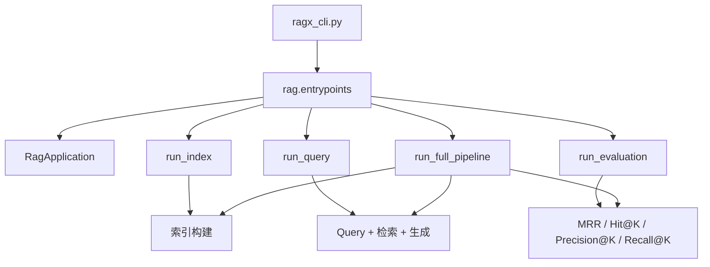

# RAGX 模块入口

本文档描述 RAGX 三个核心模块（索引构建、Query 处理、检索评估）的独立入口。每个模块既可以通过 Python Application Programming Interface (API，应用程序编程接口) 函数调用，也可以通过一个带子命令的 Command-Line Interface (CLI，命令行接口) 调用。

## 缩写说明

| 缩写 | 全称 | 说明 |
| --- | --- | --- |
| API | Application Programming Interface | Python 可调用的入口契约。 |
| CLI | Command-Line Interface | 用于独立验证模块的 Shell 命令封装。 |
| JSON | JavaScript Object Notation | 机器可读的输出格式。 |
| JSONL | JSON Lines | 每行一个 JSON 对象的评估数据集格式。 |
| MRR | Mean Reciprocal Rank | 检索排序指标。 |
| RAG | Retrieval-Augmented Generation | 基于检索证据生成答案的工作流。 |

完整缩写表见 [RAGX Abbreviations](abbreviations.md)。

## 架构



入口层只负责配置覆盖、参数校验、报告格式化和资源清理。核心的 Retrieval-Augmented Generation (RAG，检索增强生成) 行为仍然保留在 `RagApplication` 中。

## CLI 用法

在 `agent-library/ragx` 目录下运行：

```bash
python ragx_cli.py index --source data/resources --reset
python ragx_cli.py query "RAGX 如何构建索引？" --top-k 3 --reranker-backend colbert
python ragx_cli.py evaluate --query "RAGX 如何构建索引？" --relevant-source rag-sample.md
python ragx_cli.py run "RAGX 如何构建索引？" --source data/resources --evaluate
```

在 `agent-library` 目录下运行：

```bash
python ragx/ragx_cli.py index --source ragx/data/resources --reset
python ragx/ragx_cli.py query "RAGX 如何构建索引？" --top-k 3
python ragx/ragx_cli.py evaluate --query "RAGX 如何构建索引？" --relevant-source rag-sample.md
python ragx/ragx_cli.py run "RAGX 如何构建索引？" --source ragx/data/resources --evaluate
```

所有子命令都支持 `--json` 参数以输出机器可读结果。

## 索引模块

用途：独立构建 SQLite 向量库和 manifest。

CLI：

```bash
python ragx_cli.py index \
  --source data/resources \
  --sqlite-path data/stores/ragx-store.sqlite \
  --manifest-path data/stores/ragx-manifest.json \
  --reset \
  --json
```

API：

```python
from rag.entrypoints import run_index

result = run_index(
    "data/resources",
    sqlite_path="data/stores/ragx-store.sqlite",
    manifest_path="data/stores/ragx-manifest.json",
    reset=True,
)
```

校验信号：

- `report.added`、`report.updated`、`report.skipped` 确认同步行为。
- `chunk_count > 0` 确认 chunk 已持久化。
- `storage.store_exists` 和 `storage.manifest_exists` 确认存储已创建。
- `count_sqlite_chunks(sqlite_path)` 可独立验证可加载的行数。

## Query 模块

用途：加载已有索引，检索证据并生成答案。

CLI：

```bash
python ragx_cli.py query "RAGX 如何构建索引？" \
  --sqlite-path data/stores/ragx-store.sqlite \
  --manifest-path data/stores/ragx-manifest.json \
  --metadata-filter '{"is_latest": true}' \
  --top-k 3 \
  --json
```

API：

```python
from rag.entrypoints import run_query

result = run_query(
    "RAGX 如何构建索引？",
    sqlite_path="data/stores/ragx-store.sqlite",
    manifest_path="data/stores/ragx-manifest.json",
    reranker_backend="cross_encoder",
    metadata_filter={"is_latest": True},
    top_k=3,
)
```

校验信号：

- `answer` 确认生成已执行。
- `contexts` 确认返回了检索证据。
- `context_count <= top_k` 确认 query 入口控制了证据数量。
- `reranker_backend` 确认使用的是 Cross-Encoder、ColBERT 还是无重排。

## 评估模块

用途：只评估检索质量，不触发答案生成。

单条 query 的 CLI：

```bash
python ragx_cli.py evaluate \
  --query "RAGX 如何构建索引？" \
  --relevant-source rag-sample.md \
  --top-k-values 1,3,5 \
  --json
```

JSONL 数据集格式：

```json
{"query": "RAGX 如何构建索引？", "relevant_sources": ["rag-sample.md"]}
{"query": "混合检索如何融合结果？", "relevant_doc_ids": ["hybird-search.md"]}
```

数据集 CLI：

```bash
python ragx_cli.py evaluate --dataset eval.jsonl --top-k-values 1,3,5 --json
```

API：

```python
from rag.entrypoints import run_evaluation

result = run_evaluation(
    query="RAGX 如何构建索引？",
    relevant_sources=["rag-sample.md"],
    top_k_values=(1, 3, 5),
)
```

校验信号：

- `reports[].mrr` 确认 MRR 计算。
- `reports[].hit_at_k`、`precision_at_k` 和 `recall_at_k` 确认基于 K 的指标。
- `summary.average_mrr` 和 `summary.hit_rate_at_k` 确认批量聚合。

## 完整流水线

用途：把三个模块组合起来，同时保留独立入口。

CLI：

```bash
python ragx_cli.py run "RAGX 如何构建索引？" \
  --source data/resources \
  --reset \
  --evaluate \
  --relevant-source rag-sample.md \
  --json
```

API：

```python
from rag.entrypoints import run_full_pipeline

result = run_full_pipeline(
    "data/resources",
    "RAGX 如何构建索引？",
    reset=True,
    evaluate=True,
    relevant_sources=["rag-sample.md"],
)
```

返回的 payload 包含独立的 `index`、`query` 和可选的 `evaluation` 部分，测试中可以分别对每个阶段进行断言。

## 验证命令

```bash
python -m ruff check rag/entrypoints.py ragx_cli.py tests/test_module_entrypoints.py
python -m pytest tests/test_module_entrypoints.py -q
python -m pytest -q --cov=. --cov-report=term-missing
```
